*This article was translated from French.*

As a beginner in electronics, I've just built, as part of a project,
a prototype of a small robot that can move forward, backward, and turn.


<iframe width="640" height="360" src="https://peertube.video/videos/embed/95bdd4f0-630a-4184-9754-33c9f9e8f4fb" frameborder="0" allowfullscreen></iframe>

This article is for those who start from scratch, who want to control one or
two motors to build this kind of robot, and understand how it works!


## The electric motor

To produce a rotation, the motor, when powered, turns
an electric current into a rotational movement.

The direction of the current matters: depending on it, the motor turns
one way or the other.

So the motor turns if we apply a voltage across its terminals, but it
also works the other way around: if we turn the motor,
it generates a voltage across its terminals.

### Make your motor stop quickly

So, let's say we short-circuit the motor by connecting its terminals.
When turning the motor by hand, it generates a voltage.
But since the terminals are connected, each one receives from the other
an opposite current. This brakes the movement.

You can try this experiment by connecting the terminals of your motor
and turning it by hand. You'll notice it's harder than when
the terminals are not connected.

### The servomotor

There is a type of motor called a "servomotor".
This type of motor is not smarter (lol). It turns more slowly
but delivers a higher torque (a stronger push).

So it's used for tasks like opening a door: we only need
a third of a turn, but the door is heavy, so the motor must have a
significant torque. There are sometimes stops in this type of motor
to prevent it from turning more than needed, but these stops can be removed
without any problem to make our robot travel a distance.

### What we've seen

 - The motor turns a current into rotation
 - It can also turn a rotation into current
 - Short-circuiting the motor's terminals brakes it
 - The direction of the current sets the direction of the motor's rotation
 - The servomotor turns more slowly but has more torque


## The H-bridge

It's a fairly common circuit that you'll surely find whenever a motor
needs to turn both ways.

This circuit reuses all the principles seen in the previous chapter, especially
the fact that we can reverse the motor's direction by changing the direction of the current,
and brake it by short-circuiting it.

For example, to make a robot move forward or backward, you need to reverse the current,
but you can't take the robot apart and swap the terminal wiring while it's moving!

The H-bridge lets you control a motor without changing the circuit.

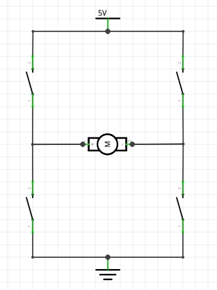

Using the switches, we can make the current flow through the motor
one way or the other by flipping two switches.

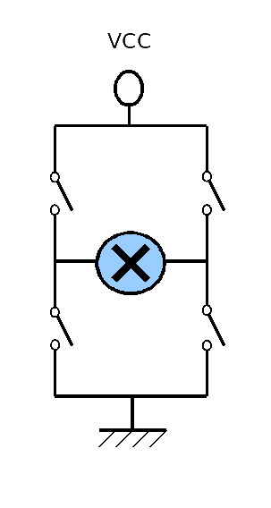

### Use the H-bridge to brake your robot

With the same circuit, we can also connect both terminals to ground
by closing the two bottom switches.
This short-circuits the motor and brakes it. It's useful to make
the robot stop as soon as we cut the power, and avoid it carrying on
with its inertia.

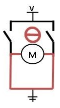

Still, be careful not to close the wrong switches
and cause a short circuit!

### What we've seen

 - The H-bridge is a common circuit to control a motor
 - It makes it easy to reverse the motor's direction
 - It can brake the motor


## The L293D integrated circuit

We've seen that the H-bridge lets us control a motor with switches.
But we're not going to run after our robot
to control it by pressing switches!

The L293D integrated circuit contains two H-bridges, and can control
up to two bidirectional motors independently, without having to worry
about flipping switches.

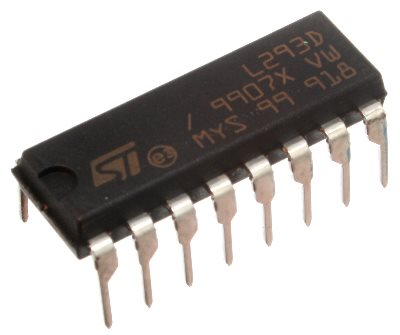

This integrated circuit also lets you power the motors
from a power source other than the Raspberry Pi.

### Don't plug the motors into the Raspberry Pi

Indeed, if you connect the motor to the Raspberry Pi's pins,
it will draw so much current that it will drain the Raspberry,
which will then reboot every second.
Moreover, your motor may need more than 5V to work.
So you'll need to power both the L293D's logic circuit
with the Raspberry's 5V, and the motors' circuit with batteries.

So there are two different circuits with two different voltages,
`Vcc1` for the logic circuit (e.g. 5V) and `Vcc2` for the motors (e.g. 9V),
that we'll have to supply on two different pins.
We'll see the wiring later.

We can see in its datasheet (<http://www.ti.com/lit/ds/symlink/l293.pdf>):

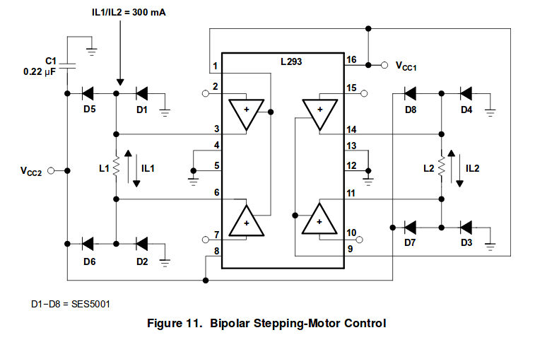

The diagram above comes from the circuit's datasheet.
In this exhaustive diagram, we can make out the two H-bridges
(yes, if you tilt your head it looks like an H).

But we don't need to know everything about this circuit, and we'll stick to the
simplified diagram also provided in the datasheet:

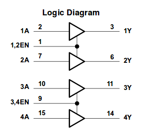

In this simplified diagram, the logic inputs are on the left (the `A`s and `EN`s).
They will be connected to GPIO pins of the Raspberry and are used to control the motors.
The connections on the right (the `Y`s) are the circuit's outputs.
We'll plug the terminals of both motors into them.
They'll get the voltage supplied by the batteries, `Vcc2`,
depending on the logic voltages (`Vcc1`) we put on the inputs.

The triangles are logical `AND` gates.
It means there will be a voltage on `1Y`
only if there is a high logic level on `1,2EN` **and** `1A`.

To know which pins of the integrated circuit match which inputs/outputs,
we can rely on this diagram from the datasheet:

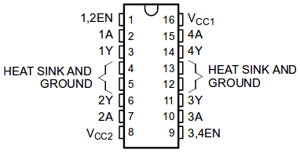

The notch on the integrated circuit tells you its orientation.

So we can connect a motor to the integrated circuit
by plugging its terminals into the `1Y` and `2Y` outputs.

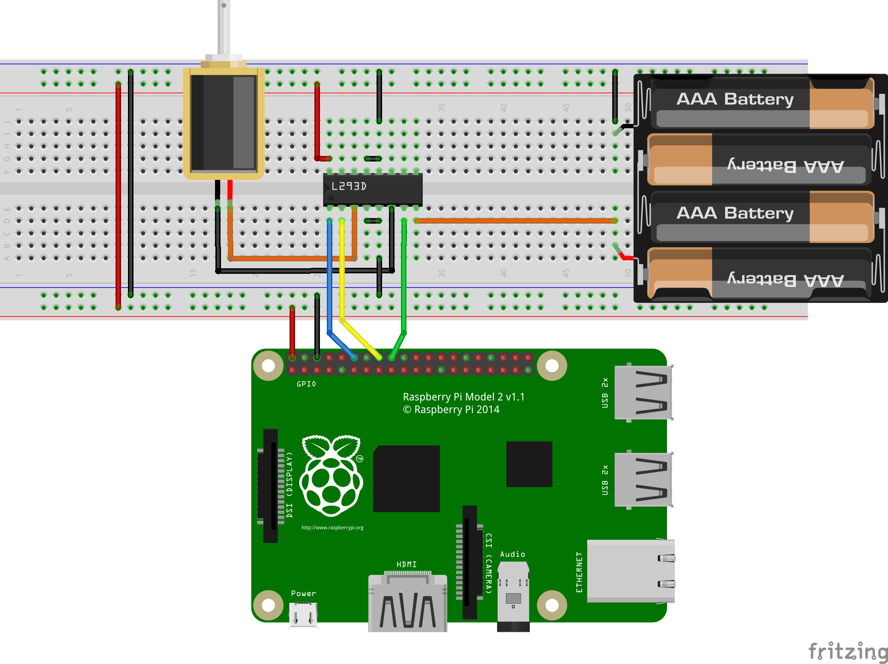

> A note about the breadboard: if you don't know it yet,
> this board lets you prototype circuits easily without soldering anything.
> The holes are connected in a way that makes it easy to connect components
> and create branches. The rows are connected together,
> and the two columns on both sides are connected too.
> This article explains how to use it in more detail:
> <https://learn.sparkfun.com/tutorials/how-to-use-a-breadboard>

Then, to make the motor turn, we need to enable the `1,2EN` input ("enable 1 and 2"),
and either put a high level on `1A` and a low level on `2A`, or the opposite.
This makes the motor turn one way or the other: it depends on which way
the motor is plugged into the circuit's `1Y` and `2Y` outputs.

If we put the same logic level on `1A` and `2A` (high/high or low/low),
there won't be any voltage across the motor, so it will freewheel.
But we've seen that the H-bridge can short-circuit the motor's terminals
to make it stop quickly. The L293D supports this:
put a low level on `1,2EN`.

To sum up how to control a motor:

Action               | `1,2EN` | `1A`   | `2A` |   |
---------------------|---------|--------|------|---|
Turn one way         | high    | high   | low  |   |
Turn the other way   | high    | low    | high |   |
Fast stop            | low     | -      | -    | whatever the `1A` and `2A` inputs |
Freewheel            | high    | low    | low  | or high/high                      |

### Beware of overheating!

Note that the L293D's logic circuit must be powered by the Raspberry Pi's 5V,
but the current coming from the batteries for the motors also flows through the L293D.
This means the circuit can dissipate a lot of energy
for its poor little size, and heat up.
It's not a problem if the motors don't run for long periods continuously,
but you'll need to fit the L293D with its heat sink if you plan
to run the motors full time.

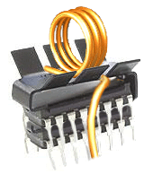

### Control a second motor

To control two motors, just plug a second one
into the circuit's `3Y` and `4Y` outputs, and apply the same logic
to the `3A`, `4A` and `3,4EN` inputs.

We'll build this circuit in the last part.

### What we've seen

 - A motor can't be plugged directly into the Raspberry Pi
 - The L293D integrated circuit contains two H-bridges
 - It can control two motors by powering some of the circuit's inputs
 - How to control a bidirectional motor with this circuit
 - It can also power the motors from another power source


## Let's build our robot

### The hardware

- The chassis

We bought a car chassis for 15€.
It includes the two wheels and motors, a battery box,
and everything needed to assemble the chassis.

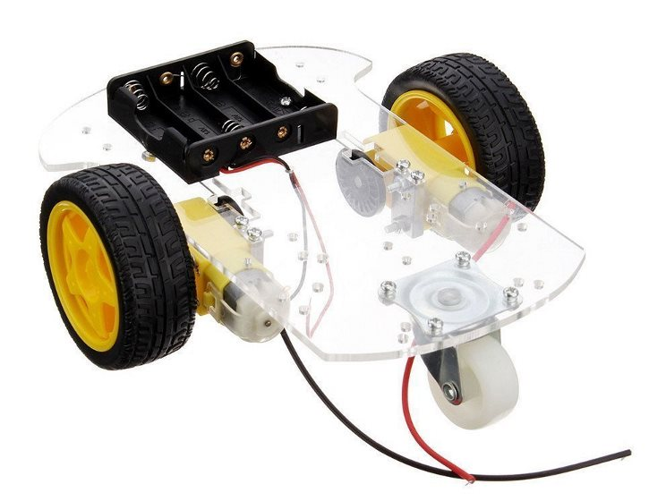

- The power supply

We've seen there are two different voltages.
One for the batteries and motors (from 4V to more than 30V),
the other for the logic circuits (often 5V or 3.3V).
So we need a battery for the logic circuit of the Raspberry Pi and of the L293D.
Note that there is a battery hat designed for the Raspberry
that can easily be mounted on it.
You can see it in the picture below, under the Raspberry Pi:

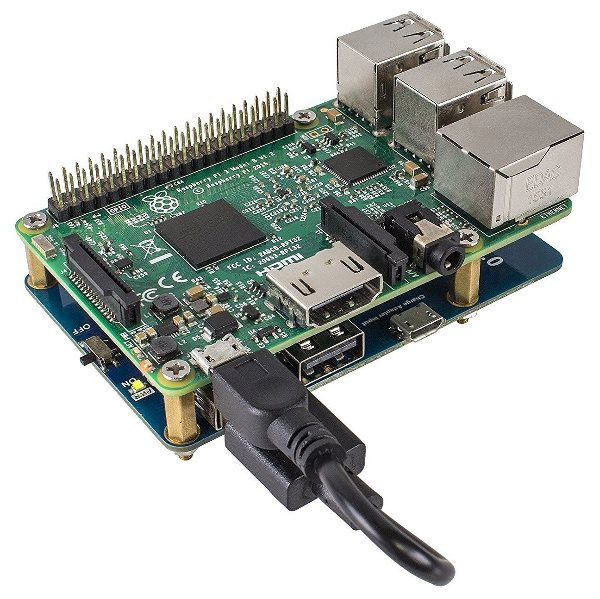

- The motor controller

We've seen above that the L293D circuit can control two motors.
For our project, we chose a more complete
controller containing a similar circuit, the L298N.

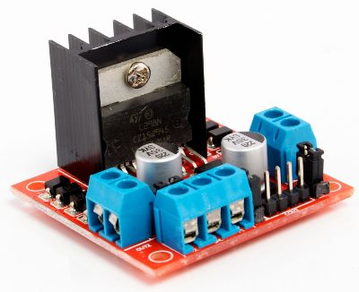

But above all, this controller includes:
 - screw terminals to connect the battery box wires
 - male pins to connect the L298N's logic inputs to the Raspberry
 - the heat sink, useful if you want to run the motors for a long time
 - protection for the circuit, with diodes and capacitors preventing current from flowing back
from the motors to the integrated circuit (when the motors generate current while still turning)

So we chose this model because it's sturdier, easier to wire,
and lets us do without the breadboard.
You'll easily find some for less than 5€ with the keywords "motor driver controller L298".

### Build your circuit

I'm going to build the following circuit on a breadboard,
to control two motors with a Raspberry Pi and the L293D circuit.

> To do it with the L298N controller, see below.

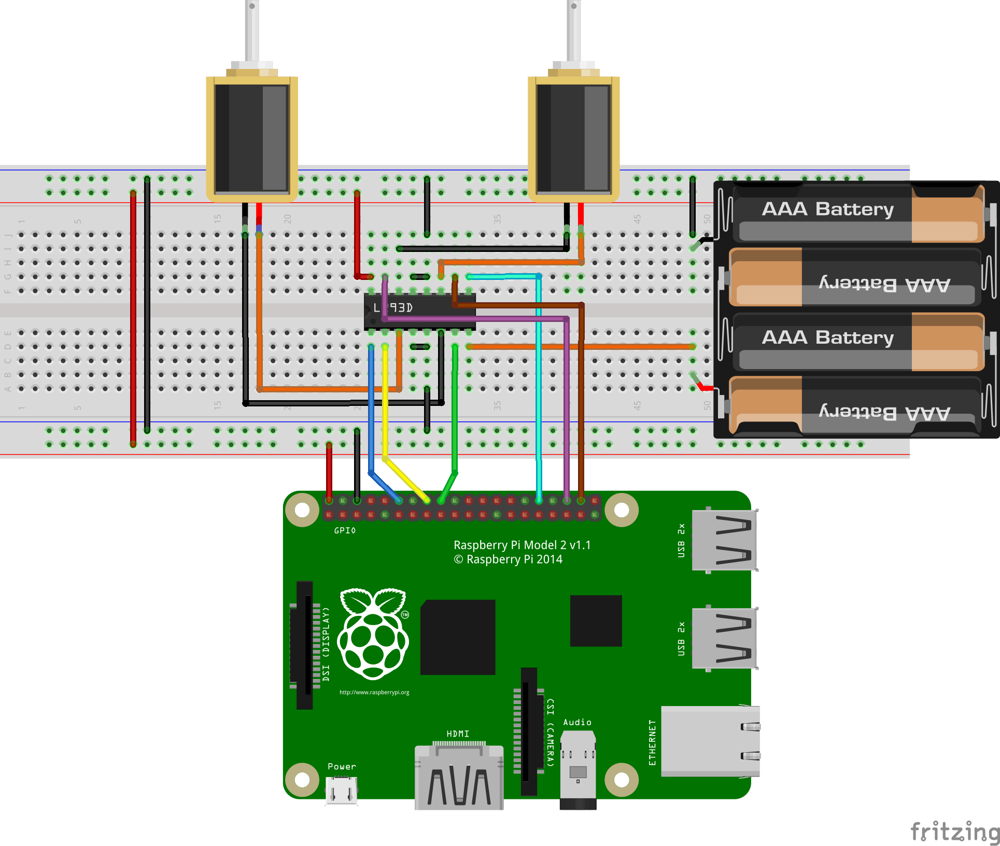

Steps and explanations:

 - Everything must be powered off

It's recommended to build the circuit while powered off. To do so,
unplug the Raspberry and remove at least one battery from the box.

 - I place the L293D in the middle

It's common to place circuits this way:
in this orientation, the pins won't be connected to the ones facing them by the board.
We can then connect the pins using the holes of the same row.

 - I power the two power rails of the board by connecting red to 5V and blue to ground.

Using the power rails means only two pins of the Raspberry are used (5V and ground).
I could use a single rail, but using two
avoids having wires crossing from one side to the other.

 - I power the L293D's logic circuit

Logic circuits often need to be powered (3.3V or 5V, here 5V) to work.
Here, it's the `Vcc1` pin and the 4 `GROUND` pins in the middle.
The pins are explained in the datasheet: <http://www.ti.com/lit/ds/symlink/l293.pdf>


 - Connect the outputs of the 2 H-bridges to the two motors

The 4 output pins, `1Y`, `2Y`, `3Y` and `4Y`, are around the ground pins.
Connect the first motor to `1Y` and `2Y`, and the other one to `3Y`, `4Y`.
The motor's direction of rotation depends on which way it's plugged in.
The easiest is to plug them randomly: you can adjust it anyway
when programming.

 - Connect the inputs of the 2 H-bridges to the Raspberry Pi

The Raspberry Pi will control the H-bridges, so I connect `1,2EN`, `1A` and `2A`
to 3 GPIO pins for the first H-bridge.
Then I do the same on the other side, for `3,4EN`, `3A` and `4A`.
So I use 6 GPIO pins to control the motors.

 - Plug in the motors' power supply

The motors' circuit must be powered on `Vcc2`.
The negative pole of the batteries must also be connected to the ground rail
so that both circuits share the same ground.

### And with the L298N controller

We can replace the L293D with this controller, and do without the breadboard.
The wiring is the same; the inputs and outputs are the following:

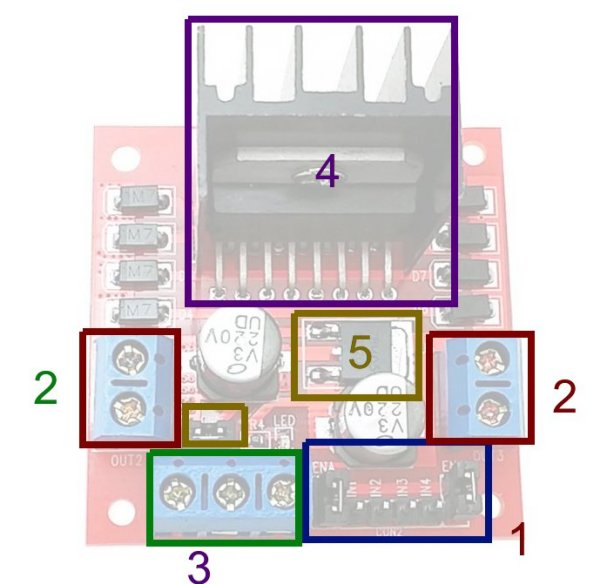

- 1: The logic inputs. `IN1` and `IN2` control the first motor, `IN3` and `IN4` the second one.
These 4 inputs must be connected to the Raspberry Pi.

Also note `ENA` and `ENB`. These are optional logic inputs.
They match `1,2EN` and `3,4EN`, which must be at a high logic level
to use the motors, but which can also be set to a low level
to make the motor stop quickly by braking it.

By default, there is a jumper on them connecting them to a high logic level.
So by default, the motors are always enabled.
But you can choose to remove the jumpers
and connect the `ENA` and `ENB` pins to the Raspberry.

- 2: The outputs matching `1Y`, `2Y`, `3Y` and `4Y`.
They must be connected to the motors' terminals.

- 3: The power supply. Connect to the 3 screw terminals:

    - `+5V`, which matches `Vcc1`: connect the Raspberry's `5V` to it
    - `+12V`, which matches `Vcc2`: connect the positive pole of the batteries to it (it doesn't matter if it's not 12V)
    - `GND`, the common ground: connect both the Raspberry's `0V` and the negative pole of the batteries to it.

- 4: The L298N integrated circuit and its heat sink.

- 5: The regulator

Using the regulator is optional. It can be useful in one case:
if your external power supply for the motors (here the batteries) provides between 5V and 12V,
you can use it to also power the L298N's logic circuit.

In that case, put the jumper on it (by default it's already there),
and you save the `5V` wire between the Raspberry and the controller.

Otherwise, if your external power supply provides less than 5V,
it won't be enough, and if it provides more than 12V, the regulator may burn out.

In any case, since the regulator's efficiency is not perfect,
it's always better not to use it,
**remove the jumper** and connect the `5V` screw terminal to a `5V` pin of the Raspberry.
This avoids losses when the regulator converts 9V or 12V into 5V:
the rest is just dissipated.

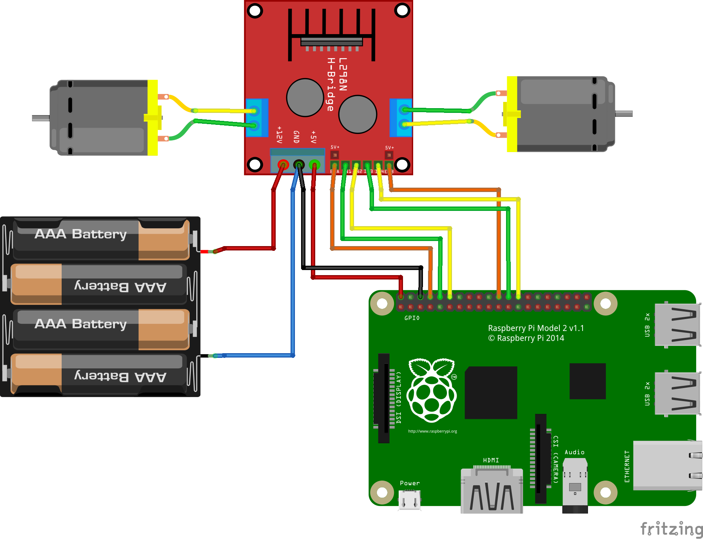

### Run the smoke test

Once the batteries are in and the Raspberry Pi is powered on, run the smoke test.
If there is a wiring mistake, the integrated circuit may start heating up.
In that case it will get hot within a few dozen seconds.
Keep an eye on it during the first two minutes after powering on.

> Anecdote: I burned an L293D by mistaking it for another, very similar-looking circuit, the SN74HC595N.
> The L293D was actually already on the breadboard, and I built the circuit
> thinking it was the SN74HC595N.
> About two minutes after powering on,
> I started to smell melting plastic.
> The integrated circuit was so hot that it melted the breadboard.
>
> So yes, a badly connected L293D can cause damage.

### Let's program it

We can now drive the Raspberry's pins with a bit of programming.
The goal is to make the robot move forward and turn.

Create a file on the Raspberry, for example `my-script.py`, and code the movement:

``` python
from time import sleep
import RPi.GPIO as GPIO

# Change these to the pins the L293D inputs are connected to
MOTOR1_EN = 14
MOTOR1_A = 18
MOTOR1_B = 15

MOTOR2_EN = 25
MOTOR2_A = 8
MOTOR2_B = 7

try:

    # Configure the pins
    GPIO.setmode(GPIO.BCM)

    GPIO.setup(MOTOR1_EN, GPIO.OUT)
    GPIO.setup(MOTOR1_A, GPIO.OUT)
    GPIO.setup(MOTOR1_B, GPIO.OUT)

    GPIO.setup(MOTOR2_EN, GPIO.OUT)
    GPIO.setup(MOTOR2_A, GPIO.OUT)
    GPIO.setup(MOTOR2_B, GPIO.OUT)

    # FORWARD

    # Make the robot move forward by turning both motors the same way
    GPIO.output(MOTOR1_EN, GPIO.HIGH)
    GPIO.output(MOTOR1_A, GPIO.HIGH)
    GPIO.output(MOTOR1_B, GPIO.LOW)

    GPIO.output(MOTOR2_EN, GPIO.HIGH)
    GPIO.output(MOTOR2_A, GPIO.HIGH)
    GPIO.output(MOTOR2_B, GPIO.LOW)

    # Keep moving forward for one second
    sleep(1)

    # Stop and brake the motors for one second
    GPIO.output(MOTOR1_EN, GPIO.LOW)
    GPIO.output(MOTOR2_EN, GPIO.LOW)
    sleep(1)

    # TURN LEFT

    # Make the robot turn left by turning the motors in opposite directions
    GPIO.output(MOTOR1_EN, GPIO.HIGH)
    GPIO.output(MOTOR1_A, GPIO.LOW)
    GPIO.output(MOTOR1_B, GPIO.HIGH)

    GPIO.output(MOTOR2_EN, GPIO.HIGH)
    GPIO.output(MOTOR2_A, GPIO.HIGH)
    GPIO.output(MOTOR2_B, GPIO.LOW)

    sleep(0.5)

    # Stop and brake the motors for one second
    GPIO.output(MOTOR1_EN, GPIO.LOW)
    GPIO.output(MOTOR2_EN, GPIO.LOW)

    # Stop after one second
    sleep(1)

    GPIO.output(MOTOR1_EN, GPIO.LOW)
    GPIO.output(MOTOR2_EN, GPIO.LOW)

except KeyboardInterrupt:
    pass
except:
    GPIO.cleanup()
    raise

GPIO.cleanup()
```

> You'll probably need to swap the `A` and `B` pin numbers
> in the source code depending on how you
> wired the motors and the controller inputs.

### Unleash the beast!

Run it from the command line on the Raspberry:

``` bash
python my-script.py
```

### And to change the motors' speed

So far, we've only used `GPIO.HIGH` or `GPIO.LOW` as inputs,
which either runs the motor at 100%, or stops it completely.

To run a motor at, say, 75%, we can apply a discontinuous voltage
to the `EN` pins. It means the Raspberry will enable the `EN` pin
75% of the time, and disable it 25% of the time. By doing this very quickly, the motor
will seem to turn continuously, but more slowly.

For this, we can use the `GPIO.PWM` object, which handles the duty cycle.

> PWM mode lets a component run at a lower intensity.
> Since we can't do that by sending fewer Volts,
> we do it by quickly switching between high and low voltage.
> This can be done on the Raspberry using PWM mode:
> <https://en.wikipedia.org/wiki/Pulse-width_modulation>

Following [the python GPIO documentation](https://sourceforge.net/p/raspberry-gpio-python/wiki/PWM/),
we can for example do this on pin 14:

``` python
import RPi.GPIO as GPIO

# Set our pin as an output
GPIO.setmode(GPIO.BCM)
GPIO.setup(14, GPIO.OUT)

# Use GPIO.PWM on our pin with a 100hz frequency (100 duty cycles per second)
pinGPIO = GPIO.PWM(14, 100)

# Start the duty cycles at 80%, so the pin is enabled for 8ms, then disabled for 2ms.
pinGPIO.start(80)
```

So we can run one of the two motors more slowly to make the robot
move forward while turning slightly, or run both motors
more slowly so the robot moves more slowly in a straight line:

``` python
from time import sleep
import RPi.GPIO as GPIO

# Change these to the pins the L293D inputs are connected to
MOTOR1_EN = 14
MOTOR1_A = 18
MOTOR1_B = 15

MOTOR2_EN = 25
MOTOR2_A = 8
MOTOR2_B = 7

try:

    # Configure the pins
    GPIO.setmode(GPIO.BCM)

    GPIO.setup(MOTOR1_EN, GPIO.OUT)
    GPIO.setup(MOTOR1_A, GPIO.OUT)
    GPIO.setup(MOTOR1_B, GPIO.OUT)

    GPIO.setup(MOTOR2_EN, GPIO.OUT)
    GPIO.setup(MOTOR2_A, GPIO.OUT)
    GPIO.setup(MOTOR2_B, GPIO.OUT)

    motor1GPIO = GPIO.PWM(MOTOR1_EN, 100)
    motor2GPIO = GPIO.PWM(MOTOR2_EN, 100)

    # FORWARD

    # Make the robot move forward slowly (50%) in a straight line
    motor1GPIO.start(50)
    GPIO.output(MOTOR1_A, GPIO.HIGH)
    GPIO.output(MOTOR1_B, GPIO.LOW)

    motor2GPIO.start(50)
    GPIO.output(MOTOR2_A, GPIO.HIGH)
    GPIO.output(MOTOR2_B, GPIO.LOW)

    # Keep moving forward for one and a half seconds
    sleep(1.5)

    # MOVE BACKWARD WHILE TURNING

    # Make the robot move backward along a curve
    motor1GPIO.start(100)
    GPIO.output(MOTOR1_A, GPIO.LOW)
    GPIO.output(MOTOR1_B, GPIO.HIGH)

    motor2GPIO.start(60)
    GPIO.output(MOTOR2_A, GPIO.LOW)
    GPIO.output(MOTOR2_B, GPIO.HIGH)

    # Keep moving backward for 2 seconds
    sleep(2)

    # Stop the motors by stopping the duty cycles
    motor1GPIO.stop()
    motor2GPIO.stop()


except KeyboardInterrupt:
    pass
except:
    GPIO.cleanup()
    raise

GPIO.cleanup()
```





