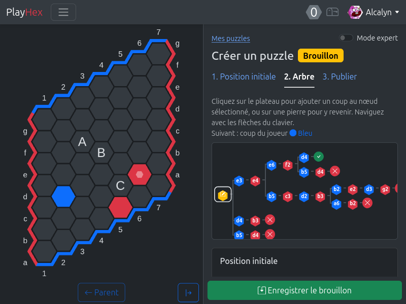
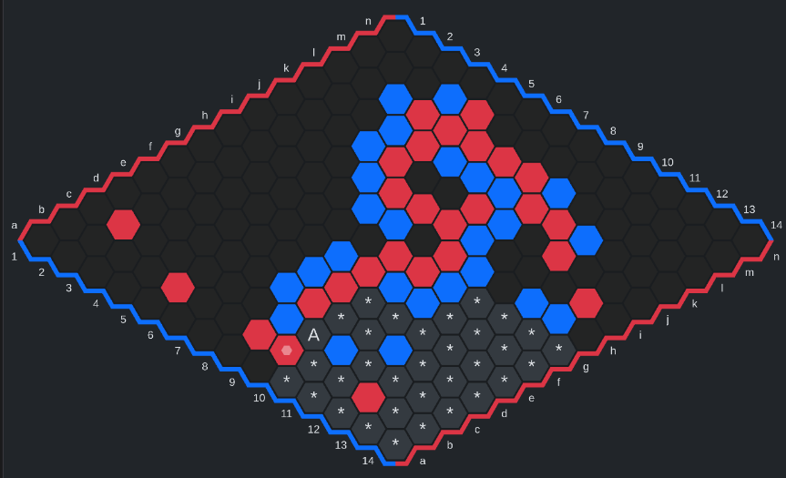
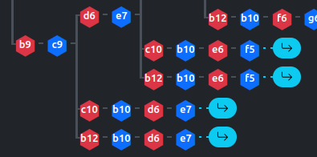
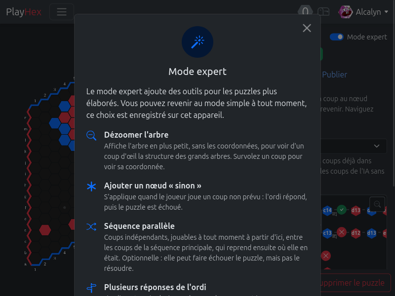
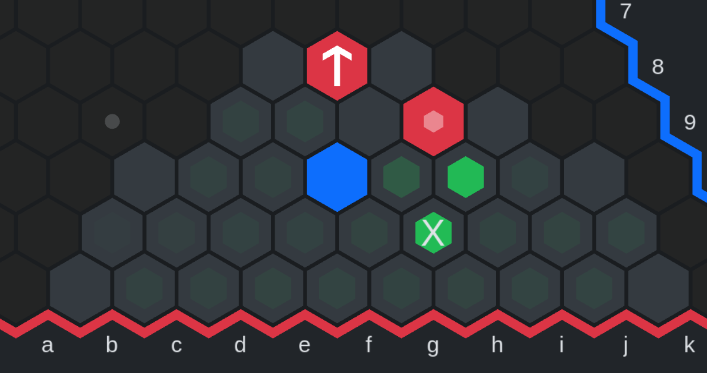

+++
date = '2026-10-25T20:08:16+01:00'
draft = true
title = "Création de l'éditeur de puzzle pour le jeu de Hex"
summary = "Au début, je pensais qu'un puzzle de Hex, c'était juste faire un arbre de décision... Tout les problèmes dont j'ai dû trouver des solutions lors du développement de l'outil d'édition de puzzle de PlayHex."
series = 'playhex'
+++

## Introduction

C'est quoi un puzzle de hex, parler des 500 puzzles de Matthew Seymour, montrer un exemple.

Je veux permettre à la communauté de créer leurs propres puzzles et les publier. Il faut donc créer un éditeur du puzzle.

## Première version

Mes objectifs :
- pouvoir créer un puzzle sur une vraie partie, comme il peut y avoir des puzzles sur une position d'échec.

Simple, un puzzle c'est "juste" un arbre de décision.

Sortie de la première version des puzzles et de l'éditeur : `9c226da0` (2 oct.)
    - Jouer un puzzle, éditeur de puzzle, créer un puzzle depuis une vraie partie (depuis Hexplorer)
    - Modèle : un arbre de décision (position initiale, coups du joueur / réponse de l'ordinateur, `result`, messages)
    - Une seule réponse de l'ordinateur par coup du joueur (les autres enfants sont ignorés)
    - Continuation après la fin du puzzle
    - Nœud "else" : réponse de l'ordinateur à n'importe quel autre coup

**Afficher `*` sur les cases couvertes par "else"** : `75de2f43` (13 oct.)

## Problème : trop de coups forcés possible

Du fait qu'un puzzle puisse être un plateau entier.

Même une position très linéaire, avec peu de choix, il est possible de jouer beaucoup de coups forcés en dehors, menacer de couper une connection virtuelle, gagnant mais qui n'apporte rien à la position.

### Isoler le puzzle en désactivant les autres cases

Solution : `cd530c50` (5 oct.)

Permettre de "griser", désactiver des régions pour isoler le problème, en les marquant "hors-puzzle".

On ne peut plus cliquer dans les regions qui sont connectée.

Exemple en ligne : https://playhex.org/puzzles/5906f6ed-3f25-4038-a289-b4613fa2815f

### Isoler le puzzle en cachant les autres cases

Comme pour les 500 puzzles de Matthew Seymour, cacher est plus utile si le puzzle veux vraiment mettre l'accent sur un concept précis au lieu d'être un puzzle sur une position, "comme dans une vraie partie".

**Plateaux partiels** (13 oct.)
    - `5d783175` : dans pixi-board, masque de cases, recadrage du plateau (`boardFit`), tests visuels
    - `6a114f74` : dans les puzzles, cacher les cases désactivées pour n'afficher qu'un coin du plateau

## Collections

`a3e78f4f` (5 oct.)

Afficher un exemple https://playhex.org/puzzles/collections/03c068c7-22e5-405d-954b-33678d45be41

Regrouper les puzzles dans un "dossier", pour les ranger.

Pas grand chose, mais permet notamment de réorganiser l'ordre des puzzles de la collection,
et passer au "puzzle suivant" quand on a résolu un puzzle.

## Problème : on peut jouer de nombreux coups dans un ordre différent

Plusieurs ordres de coups qui finissent sur une même position.

On doit pouvoir faire "converger" les lignes et continuer l'arbre sur une seule de ces lignes.

### Transpositions

`995bae6d` (5 oct.)

Détection des transpositions, quand une même position, peu importe l'ordre des coups joués,
existe déjà dans l'arbre.

Les coups sont triés par ordre alphabétique et indéxés pour retrouver plus rapidement les positions identiques.

Si on trouve une transposition, on "rejoint" et continue sur la même branche.

C'est fait automatiquement, si on détecte une transposition, on saute automatiquement sur la première branche.

## Problème : un coup forcé qui peut être joué n'importe quand fait dupliquer les branches

Montrer un exemple avec un pont

### Solution

Séquence parallèle.

Attention à ce que les coups de la séquence parallèle ne soient pas ailleur dans l'arbre,
pour éviter d'être bloqué.

Différence avec les transpositions : même avec une transposition, on aurait autant de branches que la séquence initiale, ca ferait un triangle.

Idée future : on s'en sert souvent pour un pont, mais de manière générale, ca peut permettre "d'automatiser" un template. Permettre de rendre une partie du puzzle indépendant, identifier un template et automatiser sa défense.

## Modération

Les puzzles permettent aux éditeur d'ajouter un message libre : surveiller, modération.

`f135314e` (6 oct.)

## Problème : l'UI est déjà devenu complexe avec beaucoup de boutons

Ajout d'un mode expert.

Un nouvel éditeur ne doit pas être submergé de fonctionnalité, et va probablement créer un puzzle simple.

L'UI ne doit pas le noyer : on retire le plus gros des features avancées, et on permet de les rajouter avec un switch, en affichant une explication pour chaque feature.

## Mohex et Katahex dans les puzzles

Katahex estime, MoHex prouve : pourquoi avoir les deux.

Je me sers de Mohex et Katahex pour 2 choses :

Dans l'éditeur, mettre en surbrillance les coups interessants,
et à la fin, pour vérifier un puzzle.

Mais ces 2 moteurs sont très différents :
- Mohex : prouve une connection, ne sait pas jouer de coup perdant, trouve tous les coups gagnants
- Katahex : donne une évaluation (policy) sur chaque case, même parfois les perdantes

Contraintes : Mohex => une position encore incertaine empeche Mohex de donner les coups interessants.
Katahex => a besoin d'une position réelle, inutilisable sur une position fausse créée pour le puzzle

Utilisation dans la validation :
Mohex => donne les coups gagnant, donc permet de n'oublier aucun coup qui ferait perdre le joueur alors qu'il a joué un coup gagnant
Katahex => propose des coups perdant à couvrir, des coups ayant une certaine policy que le joueur rique de jouer à tord, dans ce cas il est utile de couvrir cette ligne en montrant pourquoi c'est perdant

Donner des exemples de warnings de validation des 2 moteurs.

Bien sûr je cache les résultats des analyses, comme ca si on change un peu le puzzle et qu'on relance une analize entière, ca va recalculer seulement les nouvelles positions.

`5ab5de89` (14 oct.)
- Adapter les vérificateurs Katahex et MoHex, et les puzzles du tutoriel

Remplissage, équilibrage du nombre de pierres bleu/rouge

Le remplissage n'est pas obligé sur une position entière

## Gestion des variantes "Et qu'auriez-vous joué sur e9 ?"

`5ab5de89` (14 oct.)
- Alternatives : plusieurs réponses possibles de l'ordinateur. La première est jouée, les autres sont rejouées une fois la ligne résolue, et le joueur doit aussi les résoudre

- `2eb5a656` (16 oct.) : afficher le nombre de variantes dans l'éditeur
=> on affiche le nombre de variantes à l'éditeur pour ne pas faire de puzzle trop long. Idéalement max 1 + 2 variantes (juste une note)

### Cas de puzzle de defense : l'ordi doit jouer en premier pour avoir une alternative dés le 1er coup

`5ab5de89` (14 oct.)
- L'ordinateur joue en premier (`computerPlaysFirst`)

En voulant faire des puzzles de défense de templates, pour apprendre à défendre les templates, je voulais que l'ordi puisse avoir des variantes dont le premier coup peut changer.

Ceci afin d'apprendre les principales lignes d'intrusion dans un templates.

J'ai donc du ajouter une option pour indiquer que l'ordi joue en 1er. Ainsi, avec les variantes, l'ordi peut menacer notre template à partir de plusieurs premiers coups.

## Génération d'arbre

(en cours dans le projet...)

Toujours concernant la série de puzzles de défense de templates, j'ai voulu commencer à créer les puzzles à la main. Verdict :
- c'est très long !
- j'oublie beaucoup de coups possible, donc le joueur se retrouve avec un puzzle échoué alors que le coup est gagnant. Ca arrive sur des lignes très secondaire, ou des coups forcés, intermédiaire.
- je fais beaucoup d'erreur.

J'ai donc voulu automatiser la génération d'arbre de décision à partir d'une position.

Je voulais aussi pouvoir générer à partir d'une feuille de l'arbre pour que je puisse choisir comment l'ordi entre dans le template pour savoir si le joueur sait comment défendre avec telle ou telle intrusion.

Il a fallu savoir quand arrêter la génération, à quelle profondeur : on doit s'arreter avant de faire le chemin complet, sinon l'arbre est beaucoup plus grand, et le puzzle serait ennuyant à la fin, car il faudrait fermer tous les ponts.

Pour un puzzle plus avancé, on peut supposer que le joueur connait au moins la ziggurat et le pont, et donc on peut arrêter la génération quand une connection existe avec des ponts et des ziggurats.

Première tentative de génération :

Mohex ne sait pas générer un coup quand il est perdant. On ne peut donc pas générer de coup en tant qu'ordi, car dans un puzzle, l'ordi est perdant. J'ai donc dû compléter avec katahex :

Mohex => explorer tous les coups gagnants du joueur pour ne pas en oublier
Katahex => trouver les meilleurs candidats de réponse perdante.

Même perdant, katahex va retourner une policy pour chaque coup, qui est plutôt correcte. Ca doit venir du fait que pendant son entrainement, katahex a appris en jouant contre lui même, et il a dû apprendre que certain coup avaient plus de chances de récupérer l'avantage face à une version moins forte de lui-même. Mais tout ceci est une supposition.

Je prend donc le coup perdant qui a une meilleure policy.

(expliquer en une phrase "policy").

Ca fonctionne un peu bien (en tous cas ca fonctionne, car avec Mohex ce serait impossible).

Mais ca donne pas mal de réponses perdante qui ne donnent pas assez de fil à retordre au joueur.

Le template A5 a été un peu le bapteme du feu pour le système de génération. Je pensais pas, mais dans mes premiers tests, il a vite généré plusieurs milliers de noeuds dans l'arbre. J'ai donc pu tester un puzzle pas fini, et observer les problèmes.

Parmis les coups avec les meilleures policy, un coup est trop simple alors que l'autre est mieux pour un puzzle :

Ici, le mieux pour un puzzle serait de bloquer le joueur en le faisant entrer dans le goulot d'étranglement (bottleneck). Donc de jouer `i10`.

Ce que Katahex a bien vu, mais l'autre coup a une policy identique, mais à cause du bruit, pas de chance il a joué l'autre coup `h11`. Il suffit donc de jouer `j10` et le joueur a résolu le puzzle.

J'ai essayé d'autres méthodes, en utilisant le coup avec une certaine policy :
- qui laisse le moins de coups gagnant possible au joueur (réduire la fenetre de réussite pour forcer le joueur à calculer)
- ou qui retarde le plus la résolution du puzzle (ne pas laisser de réponse qui donne une réussite trop rapide)

Mais ces 2 solutions, en plus de demander plus de travail à mohex et katahex, donnent toujours à un moment donné un coup de l'ordi qui convient pas, soit trop simple (laisse un coup évident qui résoud le puzzle juste après), soit inutile (l'ordi essaye naivement de couper un pont).

A ce moment, je pense donc que le mieux est que la génération nous aide juste en affichant les positions, meilleures policy, et l'éditeur de puzzle choisi le meilleur coup pour le puzzle, en fonction de ce lui aurait joué pour taquiner le joueur, et de ce que katahex considère comme un coup interessant.

J'ai donc essayé de faire comme ca :

Pour les coups du joueur, mohex génère tous les coups gagnants (obligé pour pas afficher échec alors que le joueur à joué un coup gagnant).

Pour les coups de l'ordi, l'interface saute sur la position, et laisse l'éditeur choisir le coup de l'ordi. Et ainsi de suite.

Sauf que c'est encore long : pendant que je saisi les coups de l'ordi un par un, je vois "361 positions prêtes", 361 coups à faire, nombre qui va encore augmenter, car chacune de mes réponse me donne plusieurs autres coups à répondre après chaque réponse possible du joueur.

Il va falloir trouver un moyen intelligent de traiter tout un sous-arbre une seule fois, car je me rend compte que je dois traiter plusieurs positions très similaires. Les séquences parallèles et transpositions sont bien détéctées automatiquement, mais ce n'est pas suffisant.

Idée comme ca : réduire l'arbre en arretant sur des coups gagnant mais peu probable, proposer : "ce coup gagne aussi, mais trouve la ligne principale, plus directe", et revient au coup juste avant

Travail en cours sur la branche...

## Actions pratique dans l'UI

(15 oct.)
- `c74f2c02` : importer n'importe quelle partie de Hex comme position initiale
- `9bc2f173` : cloner un puzzle

18. **Bilan / suite**
