+++
date = '2019-03-24'
featuredImage = '/images/posts/pixijs-dragonbones/image-illustration-pixijs-dragonbones.jpg'
summary = 'We drew and animated a character, and developed its movement in Javascript so that it follows the mouse.'
tags = ['javascript']
title = 'Discovering pixi.js to animate a character with Javascript'
+++

*This article was translated from French.*


With the aim of making a point-and-click style game in the browser, we had to draw and animate a character, and develop its movement in Javascript so that it follows the mouse.

These were all new methods and tools we discovered. In this article, I'll show how we built the first step of our game, ...

TL;DR:

<iframe
    src="https://alcalyn.gitlab.io/game-draft/"
    class="incrusted-iframe"
    scrolling="no"
    width="630"
    height="400"
></iframe>

The example above is the result of the first step, which was to animate a character in a browser, and make it follow the pointer (mouse or finger).

This first step, which we managed after a lot of research and trials, is precisely what this article is about. I'll talk about:

- the Javascript libraries we used
- the animation software I tried and the ones I kept
- animating our character
- playing the animations in the browser.

## But first, how do you animate a character?

The first solution I thought of was to draw several images of a character, each time with the legs slightly shifted. Displaying the images one after the other would animate the character like a flip book.

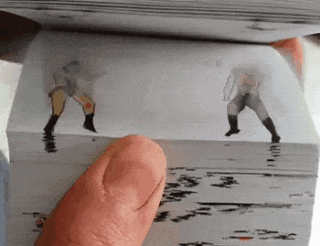

While searching the Internet for a library that already did this, I came across the Spine website, which offers a completely different solution, and its demo page, which is quite self-explanatory:

<http://esotericsoftware.com/spine-demos>

The examples are very convincing, you quickly get the idea, and it made me forget the flip book solution right away.

The idea is not to draw every state of the character, but to cut it into segments for each body part, assemble them like a puppet, and then make it walk, run, wait…

This solution has many advantages:

- No need to draw the same character several times
- The body segments can be reused for every walk
- Far fewer images to download, so it's well suited to the web

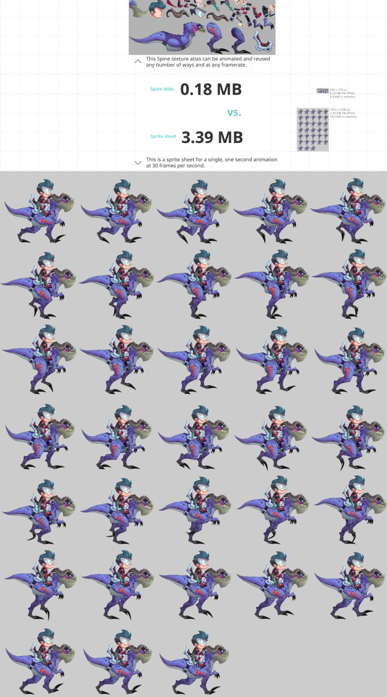

And there are more advantages, such as mesh deformation, which completely won me over, a concept illustrated by this example: <http://esotericsoftware.com/spine-demos#Mesh-deformations>

Mesh deformation lets you deform a single image to bend it. You can bend it in a way that gives a 3D feeling, as shown in this example. But I used it to bend a leg, which spared me from splitting it into 3 (thigh, shin, foot), or to bend a scarf so that it hangs and looks like it's floating in the wind.

## The software I tried and the ones I finally used

For the Javascript rendering engine, I followed the Three.js and pixi.js tutorials, and finally chose the latter, because its API seemed simpler to me.

I also discovered DragonBones, along with its open source (MIT) Javascript engine and its pixi.js integration. That settled it: I'll use pixi.js and the DragonBonesJS integration for pixi.js.

All that's left is to find the animation software that would let me animate my character and export the sprites and animations in the format DragonBonesJS expects.

### Animation software for pixi.js

I mentioned **Spine** earlier: well, it's the software I did **not** use to make our character walk!

I didn't use Spine mainly because it's proprietary software, and everything I would learn on it, or any help I might give others about it, would somehow be a contribution that isn't really open, but would stay around Spine.

Nevertheless, I tried it, and it is indeed appealing. The trial version available on the website doesn't let you save or export anything, and the personal license costs $69: affordable, but not for an experimental project.

Moreover, I later found out that a Javascript library I almost used (pixi-spine) is under the same closed license, which requires owning a paid license to use it. As a result, any software exporting animations in the same JSON format as Spine, in order to reuse the engine, can't be used without a license, even if you don't use the Spine software… In short, a dead end: let's look elsewhere.

**Synfig studio** is the first software I tried. It looked like a good alternative to Spine, but I didn't find how to export the animations to reuse them in pixi.js.

**DragonBones Pro** could have been an option: it's made by the same people who made the Javascript engine, and I could have exported the animations directly in the right format for pixi.js/DragonBonesJS, but the software requires creating an account, and anyway it doesn't work on Linux...

**Blender + the coa_tools plugin** (CutOut Animation) finally saved me. I had a hard time finding this plugin, but its author (Andreas Esau, [@ndee85](https://twitter.com/ndee85)) published [videos presenting the plugin](https://www.youtube.com/watch?v=uoQZV1f_J1s&list=PLPI26-KXCXpA-VMlDIWpmdq6M1m4LEjf_), and that's what I ended up using.

> [!NOTE]
> **About Blender**
> <br>
> Blender can do a huge number of things, but the price of this versatility is that it's rather complicated at first. However, I had already got started with it in the past, and now I have a good opportunity to use it again.

## Animating the character

The part we enjoyed the most, except that we first had to go through a step we hadn't mastered...

### Drawing the character

First, we had to draw the character.

So I used [Krita](https://krita.org/en/), a drawing program that makes you want to draw something, even when you can't draw. It's free software that runs on Linux.

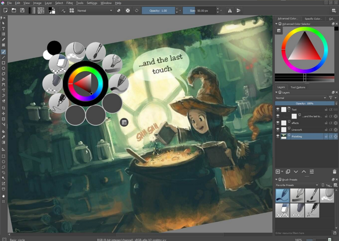

However, we didn't really know how to draw, and it was rather frustrating when your source of inspiration is:

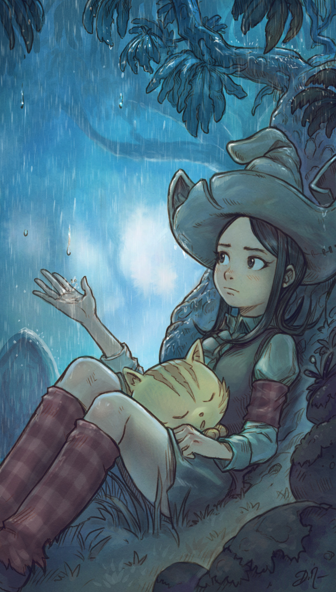

(Image: <https://www.davidrevoy.com/article603/rainy-days>)

And all you can do is:

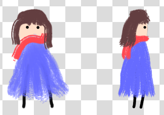

In the end, with a borrowed graphics tablet, I turned to a simple, low-commitment style within my reach, leaving room for improvement later. I took inspiration from the illustrations you can find around agile/scrum methodologies:

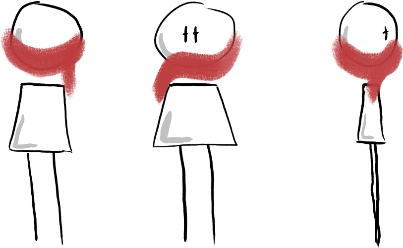

So this is the character I'll keep. I organized the layers carefully, with one for:

- the head
- the eyes: you can see the open and closed eyes stacked here
- the scarf
- the body
- and one for each leg.

I need separate layers so I can then reassemble the character as a puppet, and let each segment move freely.

### Animating the character in Blender + coa tools

This part won't be a tutorial on animating a character with Blender, but I'll show the steps that illustrate the idea.

To animate the character, I need to:

- import the segments of my drawn character into Blender
- draw a skeleton and bind the bones to the right segments of the character
- create the walk and idle animations
- export the animations and sprites to play the animations with Javascript

#### Creating the armature

So I import my character's sprites with the plugin, draw the skeleton over them, and bind each bone to the sprite(s) it's supposed to control:

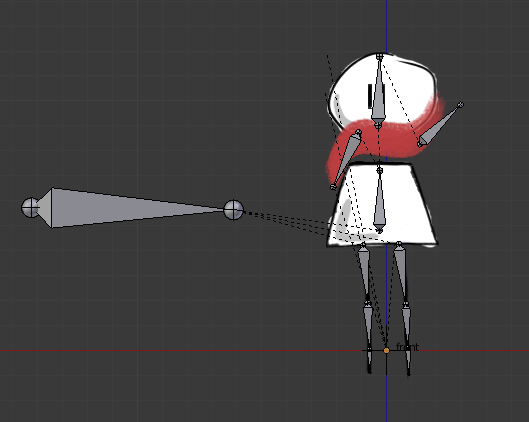

The most important thing here is that the bones are linked together with a parent/child relationship: when you rotate a bone, the child bones follow the movement.

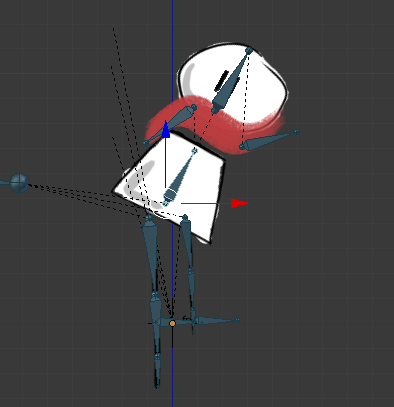

This will then help me animate a head movement or a walk without having to control the rotation of every bone individually.

I also put bones on the scarf so that it can move.

#### Character animations

After assigning all the bones to their sprites, I can animate the walk.

To do so, I need to create keyframes. In a keyframe, I can set the position and rotation of the bones at a precise moment. Then, the plugin interpolates the movement by creating the transitions between keyframes.

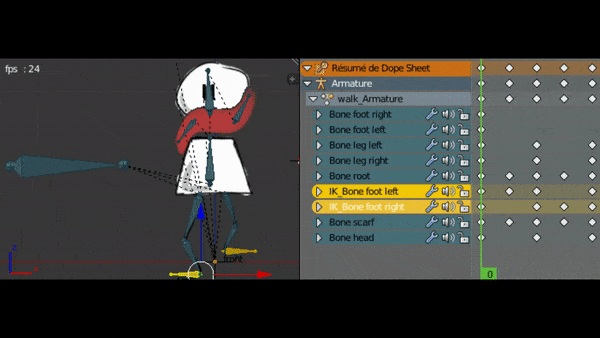

After fine-tuning my walk animation, I also make the "idle" animation, played when the character doesn't move. It makes it feel more alive.

For the eyes, I put both sprites (open eyes and closed eyes) in a "slot", a compartment that displays only one sprite at a time and lets you choose which one is shown.

#### Exporting my animation for Javascript

Once my animation is ready, the coa tools plugin lets me export the whole animation in the JSON format defined by DragonBones, so it can be reused by their Javascript engine.

The export generates:
- an image containing all the segments,
- a JSON file telling which segment is represented by which rectangle in the single sprite
- a big JSON file with the armature, the bone placement, the animations, the slots...

These three files will be imported by my Javascript application with DragonBonesJs.

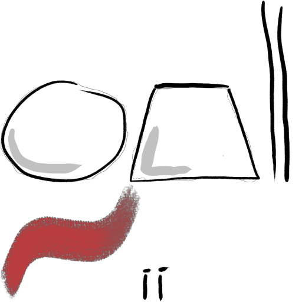

### A bit further with Blender + coa tools

I'll talk about two slightly more advanced technical details of the character animation. They're not needed to understand the rest, but I really liked them.

#### Inverse kinematics: adding natural behavior to bones

I said that child bones inherit the parent's position and rotation, to get a real puppet. But for the walk, I didn't have to bend the leg and shin for each position.

By setting up "inverse kinematics", I could instead put the foot in the right place, and the leg bends on its own, while respecting the skeleton's constraints. This helps even more to animate the walk, while giving a very natural effect:

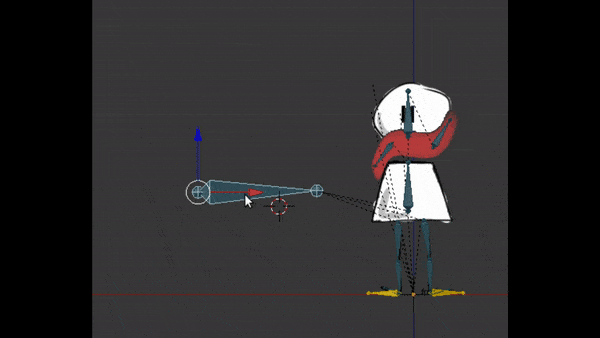

#### Mesh deformation: bending the legs and making the scarf float in the wind

When I created the skeleton, you may have noticed that the three bones of a leg control the same sprite. Indeed, the leg is a single stroke, and it would have been more cumbersome to split the 3 segments of the leg/foot.

In that case, I need to assign several bones to the same sprite, but then, how does the software know how to move the sprite when I move one of the bones?

By default, a bone doesn't rotate or deform the sprite directly, but its "mesh". And at first, a sprite's mesh has 4 vertices: the 4 corners of the image. That's not enough to deform the image with the desired precision. For example, I couldn't rotate just one end of the scarf: the whole image would be resized.

So the sprite needs to be meshed, by outlining the image and generating a mesh:

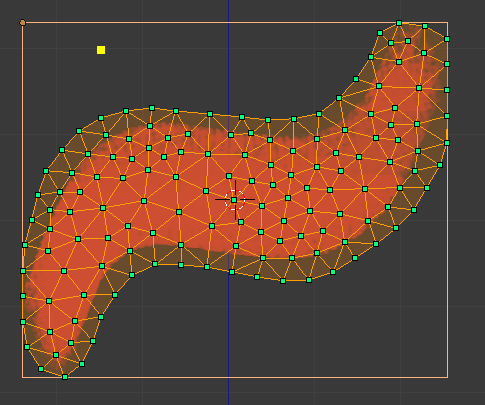

Then, you need to tell which bones control which vertices.

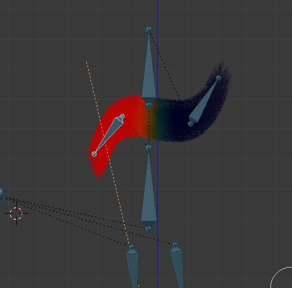

Here, the left bone controls the left half of the scarf, which rotates the whole left part instead of just moving the end. So I need to edit the weights with a brush. I reassigned them this way:

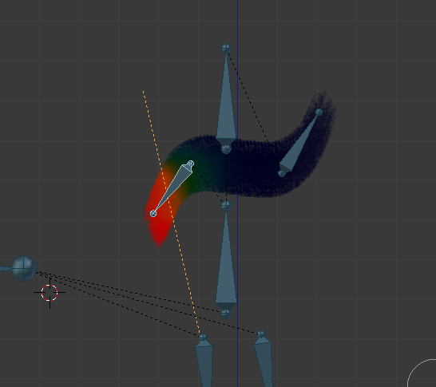

Mesh deformation can be used more precisely by redrawing over the sprite's strokes, and setting weights so as to get better renderings from simple 2D images. Moreover, DragonBonesJs displays the same deformations in the browser without any slowdown, which blew me away. I talk about it in the next part.

## Playing the animations in pixi.js / DragonBonesJS

So I created my character's animation in Blender, and exported it in the DragonBones format.

I'll now import it with the DragonBonesJS engine, more precisely with the PixiJs extension.

<https://github.com/DragonBones/DragonBonesJS/tree/master/Pixi>

> [!NOTE]
> DragonBonesJs is written in TypeScript, and they ported their engine so that it can be used with several other libraries (ThreeJS, Cocos, Egret...). That means one thing: I'll have to learn TypeScript...

### DragonBonesJs project with NPM

To use it with pixi.js, DragonBones suggests cloning their repository, copying `pixi.min.js` into it, and starting from there. I don't like that: I'm used to starting from an empty repository and installing my dependencies with NPM. It lets me keep the DragonBonesJs engine sources up to date, and avoid committing third-party sources.

It was complicated, but I managed to create my empty repository with the NPM and TypeScript environment, and the pixi.js and DragonBonesJs dependencies. I turned it into a seed, or skeleton, repo:

<https://gitlab.com/Alcalyn/pixi-dragonbones-skeleton>

This skeleton contains the TypeScript environment to develop a pixi.js/DragonBonesJS project, and the bare minimum to build this "Hello World" application: <https://alcalyn.gitlab.io/pixi-dragonbones-skeleton/>.

### Importing and playing my animation with DragonBonesJs

So I animated my character in Blender, and exported the animation to files in the DragonBones format. I now have my 3 files that I need to import, interpret and use to generate the animation with Javascript.

I use the PixiJs `Loader`, which loads assets, and `dragonBones.PixiFactory`, which generates an animation from a DragonBones export:

``` ts
// Add assets path to load
PIXI.loader.add('girl/dragonbones-export/Girl_ske.json');
PIXI.loader.add('girl/dragonbones-export/Girl_tex.json');
PIXI.loader.add('girl/dragonbones-export/Girl_tex.png');

PIXI.loader.once('complete', () => {

    const factory = new dragonBones.PixiFactory();

    // Parse skeleton and animations
    factory.parseDragonBonesData(resources['girl/dragonbones-export/Girl_ske.json'].data);

    // Parse sprites images
    factory.parseTextureAtlasData(
        resources['girl/dragonbones-export/Girl_tex.json'].data,
        resources['girl/dragonbones-export/Girl_tex.png'].texture,
    );

    // Generate armature and prepare animations (walk, idle)
    const armature = factory.buildArmatureDisplay('Armature');

    // Add armature sprite to the scene
    this.addChild(armature);
});

// Load all assets
PIXI.loader.load();
```

I can play the `walk` or `idle` animation I made in Blender:

``` ts
armature.animation.play('walk');

setTimeout(() => armature.animation.play('idle'), 3000);
```

I can show the eyes open or closed by getting the "slot" I created in Blender:

``` ts
// Open
armature.armature.getSlot('eyes').displayIndex = 0;

// Closed
armature.armature.getSlot('eyes').displayIndex = 1;
```

And so I used all these tools to make the girl walk to where you click with the mouse: <https://alcalyn.gitlab.io/pixi-dragonbones-skeleton/>

To make the girl move over time, pixi.js provides a `Ticker` that can call a function on each "tick". I used it to move the girl towards the target (where the user clicked), and update the animation (`walk` if she was standing still, `idle` if she stops walking):

``` ts
/**
 * Function called at each images per second,
 * move girl to target, depending on WALK_SPEED,
 * play `walk` or `idle` animation if girl was waiting/walking.
 */
render(deltaTime: number): void {
    if (!this.walking) {
        return;
    }

    if (Math.abs(this.x - this.targetX) > this.WALK_SPEED) {
        // If target is at right/left
        const direction = this.x < this.targetX ? 1 : -1;

        this.x += deltaTime * this.WALK_SPEED * direction;
    } else if (Math.abs(this.y - this.targetY) > this.WALK_SPEED) {
        // If target is just below/above girl
        const direction = this.y < this.targetY ? 1 : -1;

        this.y += deltaTime * this.WALK_SPEED * direction;
    } else {
        // If girl is arrived to target
        this.x = this.targetX;
        this.y = this.targetY;
        this.armature.animation.play('idle');
        this.walking = false;
    }
}

// Register render() in PIXI.ticker
PIXI.ticker.add(deltaTime => render(deltaTime));
```

> [!NOTE]
> The `deltaTime` argument is the time since the last tick, relative to the frames per second. It's usually around `1.0`, but if the animation starts lagging, it gets bigger because the ticks struggle to keep up with the frame rate. I take `deltaTime` into account here so that the girl "catches up" if the animation lags.

## Conclusion

After trying several tools, I finally found a set of compatible, free tools to create an animation with Javascript:

- [Krita](https://krita.org/en/) to draw
- [Blender](https://www.blender.org/) + [coa tools](https://github.com/ndee85/coa_tools) to animate
- [Pixi.js](http://www.pixijs.com/) / [DragonBonesJS](https://github.com/DragonBones/DragonBonesJS) to develop my game in a browser.

This article wasn't a tutorial. I was simply happy to have found a way into the world of animation, and wanted to share the techniques I discovered from my point of view as a developer.

But if you're interested and want to get into it, here are the tutorials/docs that helped me the most:

- [en] [Videos presenting Blender + coa tools](https://www.youtube.com/watch?v=uoQZV1f_J1s&list=PLPI26-KXCXpA-VMlDIWpmdq6M1m4LEjf_) (the first videos use an old version of the plugin, but they still help)
- [fr] [Tutorial to create the skeleton and inverse kinematics bones](https://cgi.tutsplus.com/fr/tutorials/how-to-rig-a-2d-character-in-blender-for-cut-out-animation-or-explainer-videos-part-1--cms-26159) This tutorial helped us a lot, but only its second half, from the "Préparation de l'Armature et rigging" part onwards. The first half is outdated, as the plugin has evolved.
- [Demo examples developed with DragonBonesJS](https://github.com/DragonBones/DragonBonesJS/tree/master/Pixi/Demos) You can clone and install this project, and play with the examples. It helped me see DragonBonesJS code examples.


