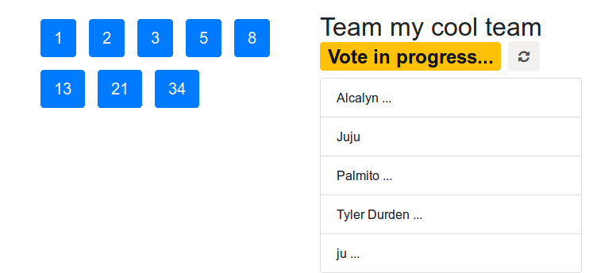
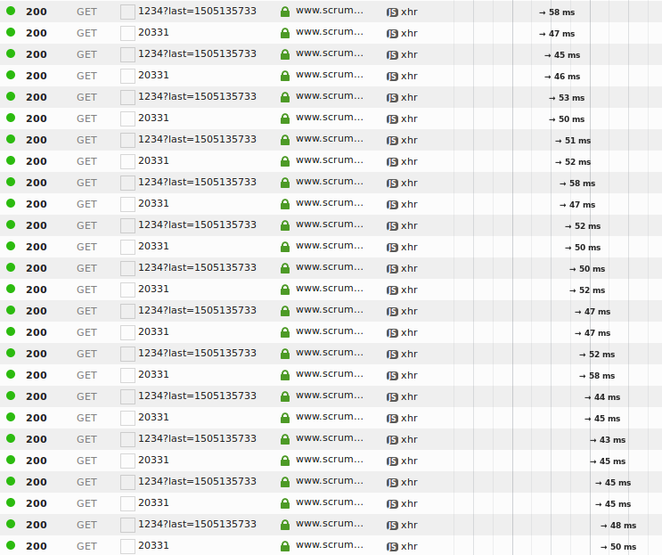
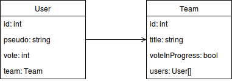

+++
date = '2017-02-13'
summary = "Êtes-vous sûr que PHP n'est pas capable d'utiliser les websockets, d'envoyer des notifications push et de faire une application temps réel ?"
tags = ['php']
title = 'Créer une application de poker planning avec PHP et les websockets'
+++

*Cet article a été traduit de l'anglais.*




En cherchant sur Github une application de poker planning temps réel,
on trouve déjà plusieurs dépôts qui utilisent les websockets :

 - [Wizehive/Firepoker](https://github.com/Wizehive/Firepoker) (Javascript)
 - [WASdev/sample.planningpoker](https://github.com/WASdev/sample.planningpoker) (JAVA)
 - [WayneYe/ScrumPoker](https://github.com/WayneYe/ScrumPoker) (Javascript)
 - [dctse/ScrumPoker](https://github.com/dctse/ScrumPoker) (Javascript)
 - [simbo1905/sprint-planning](https://github.com/simbo1905/sprint-planning) (Scala)
 - [qJake/planning-poker](https://github.com/qJake/planning-poker) (C#)
 - [richarcher/Hatjitsu](https://github.com/richarcher/Hatjitsu) (Javascript)
 - [inovex/planning-poker](https://github.com/inovex/planning-poker) (Javascript)

Écrites en Javascript (et nodejs dans beaucoup de cas), JAVA, Scala, C#...

Celle écrite en PHP que je trouve sur la première page de recherche Github,
[Toxantron/scrumonline](https://github.com/Toxantron/scrumonline), fait des requêtes ajax toutes les secondes :



Mais est-ce que ça veut dire que PHP n'est pas capable d'utiliser les websockets et de faire une application temps réel ?

J'entends souvent que PHP n'est pas bon pour les websockets, qu'il vaut mieux utiliser nodejs blablabla

En fait, si je veux construire une application temps réel,
peu m'importe d'utiliser PHP ou nodejs, ou d'utiliser les websockets ou quelque chose comme le long-polling...

Mais si vous êtes déjà dans un écosystème PHP, ou si vous aimez PHP,
vous voudrez peut-être construire votre application temps réel en PHP.

Je ne dis pas que PHP est un choix par défaut, « parce que je n'ai pas le choix »,
mais cet article va prouver qu'il est possible de construire
une application temps réel avec des websockets en PHP.

Et je le fais avec du code structuré, pas seulement un fichier `websocket-server.php`
comme on en trouve dans tous les tutos « chat PHP avec websockets » du web.


## Construisons une application temps réel

Je vais le faire avec Sandstone.
Cette bibliothèque étend Silex, donc si vous connaissez Silex,
vous connaissez déjà la moitié de ce tuto (la partie RestApi).

Sandstone ajoute aussi le support des websockets,
et fournit des outils d'abstraction pour créer des topics websocket de la manière la plus simple,
ou la plus « à la Silex ».

### Les besoins de l'application

Mon besoin est de construire une application de poker planning, où l'on peut démarrer une session de poker, laisser ses coéquipiers la rejoindre, et les laisser voter.

Dans une première partie, je vais donc construire une RestApi avec les ressources :

 - `/teams` : créer une équipe, récupérer la liste des équipes existantes, rejoindre une équipe
 - `/users` : créer un utilisateur avec un pseudo, faire voter un utilisateur (1, 2, 3, 5, 8, ...).

Ensuite, je construirai la seconde partie de l'application : le vote en temps réel avec les websockets.

> Par *vote en temps réel*, j'entends que dès qu'un utilisateur vote,
> les interfaces de tous les autres utilisateurs sont mises à jour instantanément :
> l'utilisateur envoie l'information du vote au serveur,
> puis le serveur diffuse cette information aux autres utilisateurs de l'équipe
> (pas de requête Ajax toutes les secondes).

### Stack technique

- Serveur :
    - Sandstone :
        - RestApi : créer/rejoindre des salles
        - Serveur websocket : être notifié quand quelqu'un rejoint notre équipe, vote, ou quand le vote de l'équipe est terminé, pour rafraîchir la vue en temps réel.
- Client :
    - Bootstrap 4 + jQuery + une application Js qui utilise l'api

J'utiliserai Docker et docker-compose, pour que vous n'ayez pas à installer PHP, ZMQ et l'extension PHP ZMQ.

> **Note** :
> L'application que je construis dans cet article est disponible sur Github :
> [alcalyn/poker-planning](https://github.com/alcalyn/poker-planning)


## Partie I : Rest Api avec Silex

Si vous connaissez Silex, vous connaissez déjà cette partie.
On utilise Silex pour construire une RestApi légère qui gère les ressources `/teams` et `/users`.

> [Silex](http://silex.sensiolabs.org/) est un microframework qui permet de monter facilement une application web,
> avec un routeur léger, un conteneur de services léger ([Pimple](http://pimple.sensiolabs.org/))...

### Installer Sandstone

Démarrons une application Silex, mais pas à partir de zéro.

J'utilise ici la [Sandstone edition](https://github.com/eole-io/sandstone-edition).

La Sandstone edition est un squelette Silex avec websockets, Doctrine, JMS Serializer, web profiler...

Avec Docker, en suivant [la documentation](https://github.com/eole-io/sandstone-edition) :

``` bash
curl -L https://github.com/eole-io/sandstone-edition/archive/dev.tar.gz | tar xz
cd sandstone-edition-dev/

make
```

> Docker nous aide à monter le serveur web de notre application, le serveur websocket, ...
> sans avoir à installer tout ça.

Vérifions que tout est bien installé en allant sur la page de diagnostic :
[http://0.0.0.0:8480/hello/world.html](http://0.0.0.0:8480/hello/world.html).

> S'il reste des cases orange ou rouges,
> il suffit peut-être de faire `chmod -R 777 var/*` ou `chown -R USER:GROUP .`

J'ai aussi accès au **Symfony web profiler** ici :
[http://0.0.0.0:8480/index-dev.php/_profiler/](http://0.0.0.0:8480/index-dev.php/_profiler/).


### La structure de la Sandstone edition

L'édition a en fait 2 stacks :

 - La stack **RestApi** (`app/RestApiApplication`),
 - La stack **websocket** (`app/WebsocketApplication`).

Ces 2 stacks étendent une **stack commune** (`app/Application`).

Ainsi, on ne charge pas les contrôleurs de la RestApi dans le serveur websocket,
et on ne charge pas les topics websocket dans la stack RestApi.

**Application**, la stack commune, contient :
 - les services
 - les mappings Doctrine
 - les métadonnées du serializer


→ **RestApiApplication**, la stack RestApi, contient :
 - les contrôleurs
 - les converters
 - les événements à transférer


→ **WebsocketApplication**, la stack Websocket, contient :
 - les topics websocket


### Créer le schéma de base de données et les entités avec Doctrine

Le scénario de base est :

L'utilisateur saisit son pseudo, puis voit la liste des équipes.
Il sélectionne une équipe, puis voit les utilisateurs et peut voter.



Mappons donc les entités `User` et `Team` avec Doctrine, au format yaml :

`src/App/Resources/doctrine/App.Entity.User.dcm.yml` :
``` yaml
App\Entity\User:
    type: entity
    repositoryClass: App\Repository\UserRepository
    id:
        id:
            type: integer
            generator:
                strategy: AUTO
    fields:
        pseudo:
            type: string
        vote:
            type: smallint
            nullable: true
    manyToOne:
        team:
            targetEntity: Team
            reversedBy: users
```

`src/App/Resources/doctrine/App.Entity.Team.dcm.yml` :
``` yaml
App\Entity\Team:
    type: entity
    repositoryClass: App\Repository\TeamRepository
    id:
        id:
            type: integer
            generator:
                strategy: AUTO
    fields:
        title:
            type: string
        voteInProgress:
            type: boolean
    oneToMany:
        users:
            targetEntity: User
            mappedBy: team
```

> **Note** :
> Je ne veux pas écrire les classes du modèle php à la main,
> et le mapping yaml me permet de les générer automatiquement.

Disons à Doctrine d'utiliser nos fichiers yaml (à la place du mapping `'annotation'`) :

`src/App/HelloProvider.php` :
``` php
<?php

        $app->extend('doctrine.mappings', function ($mappings, $app) {
            $mappings []= [
                'type' => 'yml',
                'namespace' => 'App\\Entity',
                'path' => $app['project.root'].'/src/App/Resources/doctrine',
                'alias' => 'App',
            ];

            return $mappings;
        });
```

Puis générons automatiquement les entités, et mettons à jour le schéma de base de données :

``` bash
# Entrer dans le conteneur php
make bash

# Générer les classes du modèle php
bin/console orm:generate-entities src/

# Mettre à jour le schéma de base de données
bin/console orm:schema-tool:update --force
```

Vous devriez voir les entités générées dans `src/App/Entity/`,
et les tables dans votre interface phpmyadmin [http://0.0.0.0:8481/](http://0.0.0.0:8481/).


### Créer les contrôleurs Rest

On veut maintenant tout un tas de routes, comme :
 - `POST /users` quand un nouvel utilisateur arrive et saisit son pseudo,
 - `GET /teams` pour la liste des équipes,
 - `PUT /teams/{team}/users/{user}` quand un utilisateur rejoint une équipe,
 - `POST /users/{user}/vote` pour qu'un joueur puisse voter...

#### Contrôleur des équipes

Je ne vais pas présenter tous les contrôleurs, juste celui de `POST /users/{user}/vote` en exemple.

> **Note** : L'application complète est disponible sur Github,
> regardez [src/App/Controller](https://github.com/alcalyn/poker-planning/tree/master/src/App/Controller)
> pour voir tous les autres contrôleurs.

Implémentons la route `POST /users/{user}/vote` :

`src/App/Controller/UserController.php`

``` php
<?php

namespace App\Controller;

use Pimple\Container;
use Symfony\Component\HttpKernel\Exception\BadRequestHttpException;
use Symfony\Component\HttpKernel\Exception\ConflictHttpException;
use Symfony\Component\HttpFoundation\Request;
use Symfony\Component\HttpFoundation\Response;
use Alcalyn\SerializableApiResponse\ApiResponse;
use DDesrosiers\SilexAnnotations\Annotations as SLX;
use App\Entity\User;
use App\Event\UserEvent;

/**
 * @SLX\Controller(prefix="/api")
 */
class UserController
{
    /**
     * @var Container
     */
    private $container;

    /**
     * @param Container $container
     */
    public function __construct(Container $container)
    {
        $this->container = $container;
    }

    /**
     * Vote. Vote number must be in body, and number in Fibonacci sequence.
     *
     * @SLX\Route(
     *      @SLX\Request(method="POST", uri="/users/{user}/vote"),
     *      @SLX\Convert(variable="user", callback="app.converter.user:convert")
     * )
     *
     * @param Request $request
     * @param User $user
     *
     * @throws BadRequestHttpException If vote is not in Fibonacci sequence.
     * @throws ConflictHttpException When trying to vote once the team has finished voting.
     *
     * @return ApiResponse
     */
    public function postVote(Request $request, User $user)
    {
        $pokerPlanning = $this->container['app.poker_planning'];
        $vote = intval($request->getContent());
        $team = $user->getTeam();

        if (!$pokerPlanning->isVoteFibonacci($vote)) {
            throw new BadRequestHttpException('Vote must be in Fibonacci sequence.');
        }

        if (!$team->getVoteInProgress()) {
            throw new ConflictHttpException('Cannot vote now, votes are closed.');
        }

        $user->setVote($vote);

        if ($pokerPlanning->hasTeamVoted($team)) {
            $team->setVoteInProgress(false);
        }

        $this->container['orm.em']->persist($user);
        $this->container['orm.em']->flush();

        return new ApiResponse(null, Response::HTTP_NO_CONTENT);
    }
}
```


### Des contrôleurs minuscules grâce aux converters

Je ne veux pas faire de `->getRepository('Team')->findById($id)` dans mes contrôleurs.

Je peux donc utiliser des converters (voir les [converters Silex](http://silex.sensiolabs.org/doc/2.0/usage.html#route-variable-converters)).

Par exemple, `src/App/Converter/TeamConverter.php` :

``` php
<?php

namespace App\Converter;

use Symfony\Component\HttpKernel\Exception\NotFoundHttpException;
use App\Repository\TeamRepository;

class TeamConverter
{
    /**
     * @var TeamRepository
     */
    private $teamRepository;

    /**
     * @param TeamRepository $teamRepository
     */
    public function __construct(TeamRepository $teamRepository)
    {
        $this->teamRepository = $teamRepository;
    }

    public function convert($id)
    {
        $team = $this->teamRepository->find($id);

        if (null === $team) {
            throw new NotFoundHttpException('Team not found.');
        }

        return $team;
    }
}
```

Je récupère ensuite comme par magie mes instances en arguments de mes contrôleurs quand je fais :

``` php
<?php

    /**
     * Make an user joins a team.
     *
     * @SLX\Route(
     *      @SLX\Request(method="PUT", uri="/teams/{team}/users/{user}"),
     *      @SLX\Convert(variable="team", callback="app.converter.team:convert"),
     *      @SLX\Convert(variable="user", callback="app.converter.user:convert")
     * )
     *
     * @param Team $team
     * @param User $user
     *
     * @return ApiResponse
     */
    public function addUser(Team $team, User $user)
    {
        $team->addUser($user);
        $user->setTeam($team);

        $this->container['orm.em']->persist($team);
        $this->container['orm.em']->flush();

        return new ApiResponse($team, Response::HTTP_OK);
    }
```

où `app.converter.team:convert` et `app.converter.user:convert`
sont des callbacks vers la méthode `convert` de TeamConverter et UserConverter.

Bien sûr, les converters doivent d'abord être déclarés comme services dans la stack RestApi :

`src/App/HelloRestApiProvider.php`

``` php
<?php

use App\Converter\TeamConverter;
use App\Converter\UserConverter;

// ...

        $app['app.converter.team'] = function () use ($app) {
            return new TeamConverter($app['orm.em']->getRepository('App:Team'));
        };

        $app['app.converter.user'] = function () use ($app) {
            return new UserConverter($app['orm.em']->getRepository('App:User'));
        };
```

### Déplacer de la logique du contrôleur vers un service

Comme vous le savez, la logique métier devrait se trouver dans des services.

Le service `app.poker_planning` contient de la logique relative au vote du Poker Planning.

`src/App/Service/PokerPlanning.php` :

``` php
<?php

namespace App\Service;

use App\Entity\Team;

class PokerPlanning
{
    /**
     * Check is a vote is in Fibonacci sequence.
     *
     * @param int $vote
     *
     * @return boolean
     */
    public function isVoteFibonacci($vote)
    {
        return in_array($vote, [1, 2, 3, 5, 8, 13, 21, 34]);
    }

    /**
     * Check whether all users voted.
     *
     * @param Team $team
     *
     * @return boolean
     */
    public function hasTeamVoted(Team $team)
    {
        foreach ($team->getUsers() as $user) {
            if (null === $user->getVote()) {
                return false;
            }
        }

        return true;
    }
}
```

Déclarons le service dans la stack commune :

Dans `src/App/HelloProvider.php` :
``` php
<?php

use App\Service\PokerPlanning;

// ...

        $app['app.poker_planning'] = function () {
            return new PokerPlanning();
        };
```

Testez votre API en récupérant toutes les équipes : <http://0.0.0.0:8480/index-dev.php/api/teams>

Je fournis aussi une collection Postman, pour que vous puissiez jouer des requêtes déjà enregistrées.
La collection est disponible ici : [poker-planning-postman-collection.json](https://github.com/alcalyn/poker-planning/blob/master/poker-planning-postman-collection.json).


## Partie II : Le temps réel avec les websockets

Bien, nous avons maintenant une RestApi fonctionnelle, sur laquelle on peut récupérer les équipes
et envoyer les votes des utilisateurs.

Maintenant, quand quelqu'un vote, je veux tenir à jour tous les clients web
et afficher en temps réel qu'un utilisateur a voté.

Mais je ne veux pas interroger ma RestApi toutes les secondes pour vérifier si l'état a changé.


### Afficher le vote d'un utilisateur en temps réel

**Le besoin** : je veux que la RestApi me prévienne quand un utilisateur vote et quand tous les utilisateurs ont voté,
pour pouvoir révéler les votes dès qu'ils sont disponibles.

Comment y arriver ?

La logique est :

1. Quelqu'un vote, et appelle `PUT /users/1/vote`.
1. La RestApi traite la requête,
1. enregistre le vote de l'utilisateur,
1. puis envoie la réponse 204 au client qui a envoyé le vote.

Mais je veux aussi que la RestApi prévienne tous mes coéquipiers que j'ai voté.

**La solution websocket** :

Tous les utilisateurs se connectent à une websocket,
c'est-à-dire une connexion qui reste ouverte
pour que le client comme le serveur puissent l'utiliser pour envoyer des messages.

La RestApi préviendra ensuite à travers cette websocket que j'ai voté.

Sandstone utilise le protocole WAMP. Donc au lieu de se connecter à la websocket
et d'écouter tous les messages sur un canal unique,
on peut créer plusieurs canaux, ou « topics », et **s'abonner** à un topic.

Les utilisateurs ne recevront alors que les messages de ce topic.

Je veux créer un topic par équipe, `teams/1`, `teams/2`, ...

Et j'enverrai les messages relatifs à l'équipe sur le canal de l'équipe.

Ensuite, chaque utilisateur qui rejoint une équipe doit aussi s'abonner au canal de l'équipe
pour recevoir les notifications en temps réel (quelqu'un a rejoint mon équipe, quelqu'un a voté).


#### Créer le topic websocket

Une fois la logique comprise, implémentons-la avec Sandstone.

Une classe `Eole\Sandstone\Websocket\Topic` porte la logique derrière un topic websocket.

Elle implémente par exemple la méthode `onSubscribe`, appelée quand un utilisateur s'abonne à ce topic.

> **Cas d'usage** : envoyer un message aux utilisateurs qui viennent de s'abonner, par exemple les derniers messages envoyés.


Elle implémente aussi la méthode `onPublish`, appelée quand un utilisateur envoie un message sur ce topic.

> **Cas d'usage** : pour un chat, rediffuser le message à tous les utilisateurs abonnés à ce topic.


Elle fournit aussi une méthode `broadcast` pour diffuser un message à tous les utilisateurs abonnés.

Créons d'abord la classe du topic, `src/App/Topic/TeamTopic.php` :

``` php
<?php

namespace App\Topic;

use Eole\Sandstone\Websocket\Topic;
use App\Event\UserEvent;

class TeamTopic extends Topic
{
    /**
     * @var int
     */
    private $teamId;

    /**
     * @param string $topicPattern
     * @param int $teamId
     */
    public function __construct($topicPattern, $teamId)
    {
        parent::__construct($topicPattern);

        $this->teamId = $teamId;
    }
}
```

Et déclarons le topic dans la stack websocket, dans `src/App/HelloWebsocketProvider.php` :

``` php
<?php

namespace App;

use Pimple\ServiceProviderInterface;
use Pimple\Container;
use App\Topic\TeamTopic;

class HelloWebsocketProvider implements ServiceProviderInterface
{
    /**
     * {@InheritDoc}
     */
    public function register(Container $app)
    {
        $app
            ->topic('teams/{teamId}', function ($topicPattern, $arguments) {
                $teamId = intval($arguments['teamId']);

                return new TeamTopic($topicPattern, $teamId);
            })
            ->assert('teamId', '\d+')
        ;
    }
}
```

Un client web de mon équipe n°1 peut maintenant s'abonner à `teams/1`, mais rien ne se passe pour l'instant.


#### Transférer l'événement de vote au topic websocket

Je veux que mon topic écoute l'événement `UserEvent::VOTED`,
qui devrait être dispatché par le contrôleur de la RestApi quand quelqu'un a voté.

Mais cet événement est dispatché dans la stack RestApi,
alors que mon topic est dans la stack websocket :
ce sont deux processus différents.

Sandstone permet de dispatcher un événement du processus RestApi vers le processus websocket en le *transférant* (forward).

Il nous faut donc créer une classe d'événement, dans `src/App/Event/UserEvent.php` :

``` php
<?php

namespace App\Event;

use Symfony\Component\EventDispatcher\Event;
use App\Entity\User;

class UserEvent extends Event
{
    /**
     * An user voted or changed his vote.
     * The listener receives an instance of UserEvent.
     *
     * @var string
     */
    const VOTED = 'event.user.voted';

    /**
     * @var User
     */
    private $user;

    /**
     * @param User $user
     */
    public function __construct(User $user)
    {
        $this->user = $user;
    }

    /**
     * @return User
     */
    public function getUser()
    {
        return $this->user;
    }
}
```

Puis dispatchons l'événement depuis le contrôleur, dans `src/App/Controller/UserController.php` :

``` php
<?php

namespace App\Controller;

use Symfony\Component\HttpFoundation\Request;
use Symfony\Component\HttpFoundation\Response;
use Alcalyn\SerializableApiResponse\ApiResponse;
use App\Entity\User;
use App\Event\UserEvent;

class UserController
{
    public function postVote(Request $request, User $user)
    {
        // ...

        // Met à jour le vote de l'utilisateur
        $user->setVote($vote);

        // Enregistre l'utilisateur
        $this->container['orm.em']->persist($user);
        $this->container['orm.em']->flush();

        // + Ajouter cette ligne : dispatche un événement avec l'entité utilisateur
        $this->container['dispatcher']->dispatch(UserEvent::VOTED, new UserEvent($user));

        // Renvoie la réponse de la RestApi
        return new ApiResponse(null, Response::HTTP_NO_CONTENT);
    }
}
```

Rien de nouveau ici : on dispatche simplement un événement avec l'EventDispatcher de Symfony.

Maintenant, on veut écouter cet événement depuis la classe Topic.
Pour que l'événement passe du processus RestApi au processus Websocket,
Sandstone nous permet de le **transférer** :

`src/App/HelloRestApiProvider.php` :

``` php
<?php

namespace App;

use Pimple\ServiceProviderInterface;
use Pimple\Container;
use App\Event\UserEvent;

class HelloRestApiProvider implements ServiceProviderInterface
{
    /**
     * {@InheritDoc}
     */
    public function register(Container $app)
    {
        // ...

        $app->forwardEventsToPushServer([
            UserEvent::VOTED,
        ]);
    }
}
```

Puis on l'écoute comme par magie dans la classe `TeamTopic` :

> Par magie, j'entends que l'instance de l'événement est sérialisée,
> envoyée au thread du serveur websocket via un serveur Push (ZeroMQ),
> puis désérialisée et redispatchée dans l'event dispatcher de l'application du serveur websocket.
>
> Ainsi, on peut écouter *comme par magie* un événement venant d'un autre thread PHP.

``` php
<?php

namespace App\Topic;

use Symfony\Component\EventDispatcher\EventSubscriberInterface;
use Eole\Sandstone\Websocket\Topic;
use App\Event\UserEvent;

class TeamTopic extends Topic implements EventSubscriberInterface
{
    /**
     * {@InheritDoc}
     */
    public static function getSubscribedEvents()
    {
        return [
            UserEvent::VOTED => 'onUserVoted',
        ];
    }

    /**
     * @param UserEvent $event
     */
    public function onUserVoted(UserEvent $event)
    {
        // Vérifie que l'événement concerne cette équipe
        if ($event->getUser()->getTeam()->getId() !== $this->teamId) {
            return;
        }

        // Diffuse à tous les clients websocket
        $this->broadcast([
            'type' => 'user_voted',
            'user' => $event->getUser(),
        ]);
    }
}
```

> **Note** :
> N'oubliez pas de redémarrer le serveur websocket
> quand le code source a changé, avec :
>
> `make restart_websocket_server`

#### Se connecter au serveur websocket depuis votre application Javascript

Il vous faudra tester ça avec un client websocket Javascript.

Une bibliothèque JS utilisable avec Sandstone (protocole WAMPv1/Websocket)
est AutobahnJS 0.8.

> **Note** : une autre pourrait être [wamp1](https://www.npmjs.com/package/wamp1),
> qui peut être installée avec npm, mais je ne l'ai pas encore testée.

Pour faire court, ça ressemblera à quelque chose comme :

``` js
console.log('connecting to websocket server...');

ab.connect(
    'ws://0.0.0.0:8482',
    function (session) {
        console.log('connected to websocket server.');

        console.log('listening team topic');

        session.subscribe('teams/'+myTeam.id, function (topic, event) {
            console.log('something happens in my team');
            console.log(event.user.pseudo+' votes '+event.user.vote);
        });
    },
    function (code, reason, detail) {
        console.warn(code, reason, detail);
    }
);
```

L'application complète, front et back, peut être installée et testée ici :

💻 [Poker Planning](https://github.com/alcalyn/poker-planning)





