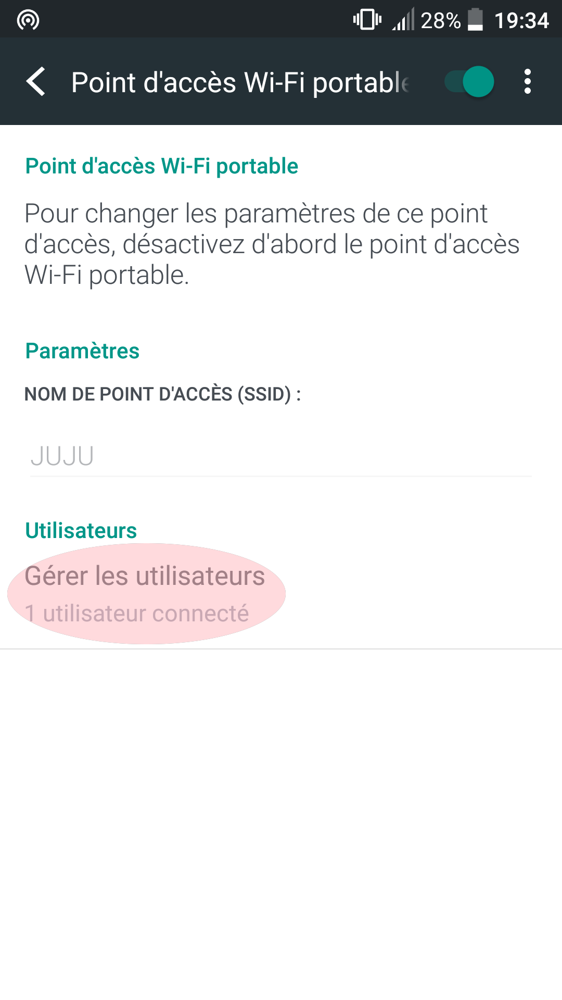

+++
date = '2017-09-09'
summary = 'You already use SSH to control your Raspberry from the command line. But what if you move around with your Raspberry?'
tags = ['raspberry-pi']
title = 'Control your Raspberry Pi from your phone to make it more portable'

[[workflow-configure]]
  alt = 'Android wi-fi hotspot screenshot'
  image_path = 'a-configure-1.png'
  title = 'Android settings'

[[workflow-configure]]
  alt = 'Android wi-fi hotspot screenshot'
  image_path = 'a-configure-2.png'
  title = 'Advanced Android settings'

[[workflow-configure]]
  alt = 'Android wi-fi hotspot screenshot'
  image_path = 'a-configure-3.png'
  title = 'Mobile network sharing'

[[workflow-configure]]
  alt = 'Wi-fi hotspot configuration'
  image_path = 'a-configure-4.png'
  title = 'Wi-fi hotspot configuration'

[[workflow-connect]]
  alt = 'The Raspberry Pi connected to our phone'
  image_path = 'c-connect-1.png'
  title = 'The Raspberry Pi connected to our phone'

[[workflow-connect]]
  alt = 'List of clients connected to our wi-fi hotspot'
  image_path = 'c-connect-2.png'
  title = 'List of clients connected to our wi-fi hotspot'

[[workflow-connect]]
  alt = 'Android wi-fi hotspot screenshot'
  image_path = 'c-connect-3.png'
  title = 'IP address given to the Raspberry by the phone'

[[workflow-console]]
  alt = 'Android ConnectBot Raspberry Pi screenshot'
  image_path = 'd-console-1.png'
  title = 'Connecting to the Raspberry Pi with ConnectBot'

[[workflow-console]]
  alt = 'Android ConnectBot Raspberry Pi screenshot'
  image_path = 'd-console-2.png'
  title = 'Typing the password asked by SSH'

[[workflow-console]]
  alt = 'Android ConnectBot Raspberry Pi screenshot'
  image_path = 'd-console-3.png'
  title = 'We took control of our Raspberry'
+++

*This article was translated from French.*


You already use SSH to control your Raspberry from the command line.

To do so, you plug it with Ethernet directly to your PC,
or remotely by connecting it with wi-fi to your router to access it on your local network.

But what if you move around with your Raspberry Pi because:

 - you plugged it to a battery and want to access it in your car
 - you embedded it in a portable object that you take outside your home

You won't have your router's local network anymore, and you won't keep
your PC with you to plug it in.

I recently embedded my Raspberry in a physical object
and wanted to carry it somewhere other than home, outside my wi-fi.

I'll explain in this article how I managed to access
the Raspberry with SSH in this situation.

You will need:

 - some good rice
 - your Raspberry
 - a phone that can act as a wi-fi hotspot
 - a terminal application on your phone, for example [ConnectBot](https://play.google.com/store/apps/details?id=org.connectbot&hl=fr).


## The wi-fi hotspot

Nowadays, many phones can act as a wi-fi access point, or "hotspot".
Usually, the hotspot is used to share Internet access
by using it together with mobile data.

When you enable your wi-fi hotspot, your phone becomes a kind of router,
and lets other phones connect to it with wi-fi, like to a home router,
by knowing the wi-fi network name, the SSID, and the password if any.

When a phone connects to your hotspot,
your phone gives it a local IP address,
exactly like your home router would.
That phone can then join the local network created by your host phone.

## Configure your hotspot

First, you need to know or define the SSID of your phone's wi-fi hotspot.
On Android, go to the settings, enter a name (or keep the existing one),
and configure the security, WPA or none.



> I didn't set a password because I don't need one:
> I will only enable the hotspot occasionally.

You now know your SSID and your password if any.

Now configure your Raspberry.

## Configure your Raspberry Pi

So you've put your phone in wi-fi hotspot mode.

Here, it's not about offering Internet access to other people,
but about letting your Raspberry connect to it. It will then be
in your phone's local network, get an IP address,
and you'll be able to access it from your phone.

The goal is to make your Raspberry Pi connect to it on its own,
and to find out which IP address your phone gave it, so you can connect to it with SSH
using the terminal application.

You may already have done this when you configured
your Raspberry to connect to your home router with wi-fi.

On your Raspberry, just open the file
`/etc/wpa_supplicant/wpa_supplicant.conf`,
and add your phone's SSID:

``` bash
sudo nano /etc/wpa_supplicant/wpa_supplicant.conf
```

Add your phone with the right SSID in the file:

```
network={
	ssid="JUJU"
	proto=RSN
	key_mgmt=NONE
}
```

If you already have another `network`, for example your home router's,
that's fine. Add your phone below it, and add an `id_str`
to tell the two `network`s apart. This `id_str` is required when
there are several of them.

Here is my complete `wpa_supplicant.conf`:

```
country=GB
ctrl_interface=DIR=/var/run/wpa_supplicant GROUP=netdev
update_config=1

network={
	ssid="MaBox"
	psk="xxxxxxxx"
	id_str="maison"
}

network={
	ssid="JUJU"
	proto=RSN
	key_mgmt=NONE
	id_str="telephone"
}
```

That should be it. Now:

- start the wi-fi hotspot on your phone.
- make sure your Raspberry doesn't connect to your home router's wi-fi instead of your phone.
- reboot your Raspberry Pi.

> To prevent your Raspberry from connecting to your home router, you have several options:
>
> - either turn off your router's wi-fi (no more wi-fi at home)
> - or, in your Raspberry's `wpa_supplicant.conf` file, rename your router's SSID by adding a suffix such as `_old` (you'll have to restore it to get Internet back on the Raspberry)
> - or get out of your wi-fi coverage (well, you'll have to walk)

Wait for it to boot and connect.
You should see your Raspberry connect to your hotspot in the menu:



## Connect with SSH

Your phone should have given an IP address to the Raspberry.
You need it to connect.
You can find it by listing the connected devices:



Then, all that's left is to connect with the terminal application
(here [ConnectBot](https://play.google.com/store/apps/details?id=org.connectbot&hl=fr)),
by entering the IP address I got and the SSH username (`pi` by default).
So I type `pi@192.168.43.113` in the `username@hostname port` field,
leave the other fields as default and confirm.

The Raspberry then asks for the SSH password,
`raspberry` by default if you haven't changed it.



There you go, you took control of your Raspberry Pi from your phone.

## Going further

In this article, we only use the wi-fi connection to connect with SSH,
but we could imagine the Raspberry hosting a server application,
for example a web server, and using it from the phone with a simple
web browser, or an application that connects to the Raspberry.

By embedding the Raspberry in an object, we could control this object
from our phone, send it commands, and get data from the Raspberry's
sensors.

### What if the Raspberry provided the hotspot

Instead of configuring your Raspberry to connect to your phone,
it could provide the hotspot itself.
I didn't manage to do it, but by following this article,
[Créer un hotspot Wi-Fi en moins de 10 minutes avec la Raspberry Pi](https://raspbian-france.fr/creer-un-hotspot-wi-fi-en-moins-de-10-minutes-avec-la-raspberry-pi/) (in French),
you could connect to your connected object from your phone,
rather than the other way around.

That would be simpler from a user's point of view,
and you could even have an SSID named after your connected object.

A first step towards home automation...



