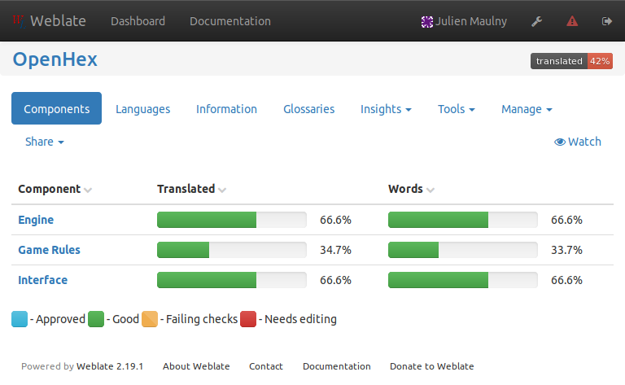
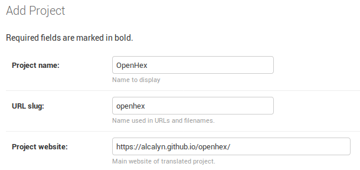
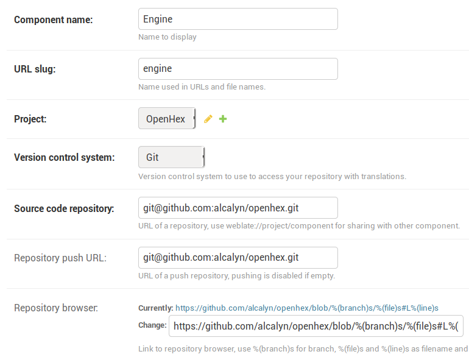
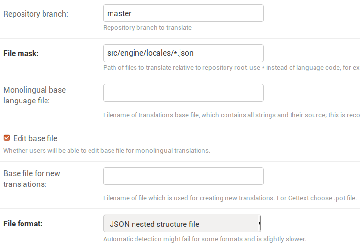
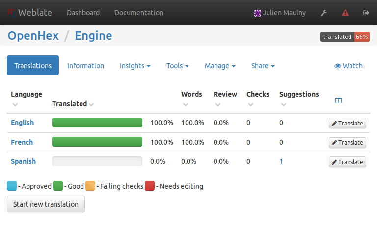
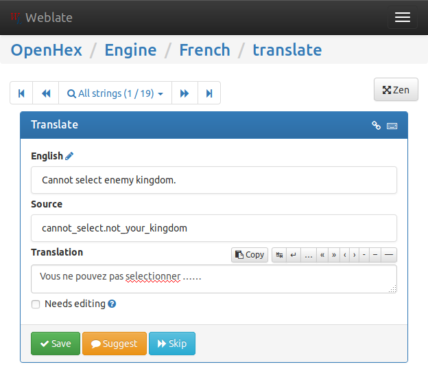

+++
date = '2018-03-14'
featuredImage = '/images/posts/set-up-continuous-translation-i18next-weblate/weblate-screenshot.jpg'
summary = "J'ai récemment créé un projet ReactJS avec i18next, et installé Weblate, une interface de traduction libre, pour permettre à tout le monde d'aider à traduire l'application."
tags = ['javascript']
title = 'Mettre en place la traduction continue avec Weblate et i18next'
+++

*Cet article a été traduit de l'anglais.*




J'ai récemment créé un projet ReactJS ([Openhex]()).

J'ai utilisé [i18next](https://www.i18next.com/) pour le traduire en anglais et en français,
et [Weblate](https://weblate.org) pour permettre aux contributeurs d'aider aux traductions
via une interface web, en traduisant des phrases, voire en ajoutant de nouvelles langues.


## Traduire avec i18next

J'avais deux sources de chaînes dans mon code source :

- Dans le code source Javascript

``` js
throw new IllegalMoveError('You have not enough money to buy an unit.');
```

- Dans les templates ReactJS

``` html
<button onClick={ () => { this.buyUnit(); } }>
  Buy an unit
</button>
```

C'est une application front (pas un backend nodejs).
Je voulais utiliser des clés de traduction, c'est-à-dire
utiliser une clé constante et unique, puis la traduire en anglais
et dans les autres langues :

``` js
throw new IllegalMoveError('You have not enough money to buy an unit.');
```

devient :

``` js
throw new IllegalMoveError('cannot_buy_unit.not_enough_money');
```

J'ai regardé de nombreuses bibliothèques d'i18n, et j'ai finalement choisi i18next
pour sa grande communauté et tous les modules existants, en particulier :

- [react-i18next](https://react.i18next.com/) pour traduire les templates ReactJS,
- [i18next-scanner](http://i18next.github.io/i18next-scanner/) pour analyser mon code source et extraire automatiquement les chaînes à traduire dans les fichiers de traduction,
- [i18next-browser-languageDetector
](https://github.com/i18next/i18next-browser-languageDetector) pour définir automatiquement la langue
de l'application en la devinant depuis le navigateur de l'utilisateur.

Commençons par traduire les chaînes Javascript
(on traduira les templates react plus tard).


### Installer i18next

Avec `npm` :

``` bash
npm install i18next --save
```

Ce qui a installé la version `^10.5.0`.


### Configurer i18next

I18next permet de configurer l'instance principale du module,
ou une « instance créée ».
Si vous n'avez qu'un seul dossier de fichiers de traduction,
vous pouvez utiliser l'instance principale d'i18next,
c'est-à-dire la configurer comme ceci :

**src/i18next.js** :
``` js
import i18next from 'i18next';
import { en, fr, es } from './engine/locales';

# Configure i18next
i18next.init({

  # Utile pour débugger, affiche les clés manquantes
  debug: true,

  # Langue de traduction (sera définie dynamiquement plus tard)
  lng: 'en',

  # Langue à utiliser si une clé de traduction est manquante
  fallbackLng: 'en',

  # Namespace utilisé par défaut, quand il n'est pas indiqué
  defaultNs: 'translation',
});

# Je charge mes fichiers de traduction
i18next.addResourceBundle('en', 'translation', en);
i18next.addResourceBundle('fr', 'translation', fr);
i18next.addResourceBundle('es', 'translation', es);
```

**src/engine/locales/index.js** :
``` js
import en from './en.json';
import fr from './fr.json';
import es from './es.json';

export {
    en,
    fr,
    es,
};
```

**src/engine/locales/en.json** (en JSON imbriqué) :
``` js
{
  "cannot_buy_unit": {
    "not_enough_money": "You tried to buy or upgrade an unit, but you have only {{playerMoney}} gold, and an unit costs {{unitPrice}}."
  }
}
```

(et la même chose dans `fr.json`, `es.json`, avec les chaînes traduites).

Vous pouvez maintenant traduire des chaînes dans le code source en réutilisant le module `i18next`,
puisque la configuration a été chargée dans l'instance principale avec `i18next.init()` :

``` js
import i18next from 'i18next';

i18next.t('cannot_buy_unit.not_enough_money', {
  playerMoney: 4,
  unitPrice: 10,
});
```


### Utiliser i18next.createInstance()

L'exemple ci-dessus fonctionne bien pour une unité de traduction « simple »
(un seul dossier de traduction et une seule configuration).

Dans mon cas, j'avais plusieurs dossiers de traduction, avec
des formats de fichiers différents
(l'un en JSON imbriqué, l'autre en JSON à plat).

> [!NOTE]
> **Pourquoi plusieurs dossiers de traduction ?**
> Je voulais séparer les traductions du moteur
> de celles de l'interface utilisateur, pour pouvoir
> facilement sortir la logique du moteur dans un autre dépôt.
> Et je préférais plusieurs petites unités de traduction
> avec des responsabilités différentes.

Créons une instance d'i18next pour le composant moteur.
Il suffit d'utiliser `i18next.createInstance().init({ ... })`
pour configurer uniquement une nouvelle instance d'i18next au lieu de
l'instance principale. Ensuite, puisque j'ai créé ma propre instance,
je dois l'exporter comme module pour la réutiliser :

**src/i18next.js** :
``` js
import i18next from 'i18next';
import { en, fr, es } from './engine/locales';

# Crée une nouvelle instance d'i18next
const i18n = i18next.createInstance();

# même config...
i18n.init({
  debug: true,
  lng: 'en',
  fallbackLng: 'en',
  defaultNs: 'translation',
});

# chargement de mes fichiers de traduction
i18next.addResourceBundle('en', 'translation', en);
i18next.addResourceBundle('fr', 'translation', fr);
i18next.addResourceBundle('es', 'translation', es);

# Puis, chose importante, j'exporte mon instance
export default i18n;
```

Traduire avec ma nouvelle instance ressemble à ça :

**src/myscript.js** :
``` js
# Import de mon instance i18next
import i18n from './i18next';

# utilisation
i18n.t('cannot_buy_unit.not_enough_money', {
  playerMoney: 4,
  unitPrice: 10,
});
```

Ainsi, je peux créer une autre instance avec une configuration complètement différente :

**src/other-component/i18n/index.js** :
``` js
import i18next from 'i18next';
import { en, fr } from './locales';

const i18n = i18next.createInstance();

i18n.init({
  debug: true,
  lng: 'fr',
  defaultNs: 'messages',
});

# chargement de mes fichiers de traduction
i18next.addResourceBundle('en', 'messages', en);
i18next.addResourceBundle('fr', 'messages', fr);

export default i18n;
```

> [!NOTE]
> **Note sur le clonage d'instance** :
> i18next permet de [cloner une instance](https://www.i18next.com/overview/api#cloneinstance)
> pour réutiliser une instance existante
> en surchargeant une partie de la configuration.

### Traduire les templates React

TLDR :

``` html
return (
  <button onClick={ () => { this.buyUnit(); } }>
    Buy an unit
  </button>
);
```

devient :

``` js
# Import du composant react I18n
import { I18n } from 'react-i18next';

# Import de votre instance i18next
import i18n from './i18n';

return (
  <I18n i18n={ i18n }>
    {t => (
      <button onClick={ () => { buyUnit(); } }>
        { t('buy_unit') }
      </button>
    )}
  </I18n>
);
```

Installer et utiliser ce module ne m'a pas posé beaucoup de problèmes :

<https://react.i18next.com/overview/getting-started>.

L'idée est d'utiliser le composant react `I18n`,
et de lui passer votre propre instance i18next en prop : `<I18n i18n={ i18n }>`.

Ensuite, vous pouvez utiliser la fonction `t` pour traduire des chaînes
<br>
dans votre template : `<p>{ t('my_string') }</p>`.

Voici à quoi ça ressemble au final dans une vraie application :
<https://github.com/alcalyn/openhex/blob/f799a693914b0deae70612c5a78958423dcd0d60/src/components/GameMenu.js#L29-L47>.


### Traduire dynamiquement en devinant la langue de l'utilisateur

Installez le module [i18next-browser-languageDetector](https://github.com/i18next/i18next-browser-languageDetector#getting-started) :

``` bash
npm install --save i18next-browser-languagedetector
```

Ce qui a installé la version `^2.1.0`.

Puis configurez le module :

``` js
import LngDetector from 'i18next-browser-languagedetector';

i18next
    # Déclare le module
    .use(LngDetector)

    .init({
        debug: true,
        fallbackLng: 'en',
        defaultNs: 'translation',
        # lng: 'en',    <= Supprimer cette ligne, sinon elle écrase la détection automatique

        # Configure le module
        detection: {
            # Je veux deviner la langue depuis :
            #   - la querystring d'abord (avec ?lng=fr dans l'url)
            #   - ou le navigateur (l'Accept-Language du navigateur je suppose)
            order: ['querystring', 'navigator'],

            # On peut changer ici le paramètre de query string pour personnaliser les urls
            lookupQuerystring: 'lng'
        }
    })
;
```

Voir la [référence de configuration du module ici](https://github.com/i18next/i18next-browser-languageDetector#detector-options).


### Extraire automatiquement les clés de traduction du code source

Une dernière chose pour automatiser une étape pénible : copier toutes les clés de traduction
du code source et des templates, et les coller dans tous les fichiers de traduction.

Je ne veux pas chercher chaque clé de traduction comme `t('home_page')` ou `<h2>t('game_rules')</p>`,
puis les coller à la main dans chaque fichier `en.json`, `fr.json`, ... et dans les éventuelles futures langues.

J'ai donc utilisé [i18next-scanner](http://i18next.github.io/i18next-scanner/)
pour analyser mon code source et extraire automatiquement les chaînes dans les fichiers de traduction.

En lançant `i18next-scanner` avec un fichier de configuration, il met automatiquement à jour mes fichiers de traduction
en ajoutant les nouvelles clés et en conservant les chaînes déjà traduites...

Je l'ai installé avec

``` bash
npm install i18next-scanner --save-dev
```

Ce qui a installé la version `2.4.6`.

J'ai des chaînes à traduire à la fois dans le code source javascript et dans les templates react.

J'ai donc créé 2 fichiers de configuration, en voici un en exemple :

**i18next-scanner.config.engine.js** (à la racine) :
``` js
module.exports = {
    options: {
        debug: true,
        // lit les chaînes depuis les fonctions : IllegalMoveError('KEY') ou t('KEY')
        func: {
            list: ['IllegalMoveError', 't'],
            extensions: ['.js'],
        },

        trans: false,

        // Crée et met à jour les fichiers `en.json`, `fr.json`, `es.json`
        lngs: ['en', 'fr', 'es'],

        ns: [
            // Le namespace que j'utilise
            'translation',
        ],

        defaultLng: 'en',
        defaultNs: 'translation',

        // Met une chaîne vide comme traduction initiale
        // (utile pour que Weblate la marque comme 'pas encore traduite', voir plus loin)
        defaultValue: (lng, ns, key) => '',

        // Emplacement des fichiers de traduction
        resource: {
            loadPath: 'src/engine/locales/{{lng}}.json',
            savePath: 'src/engine/locales/{{lng}}.json',
            jsonIndent: 4,
        },

        nsSeparator: ':',
        keySeparator: '.',
    },
};
```

J'ai ajouté le script suivant dans mon fichier `package.json` :

``` json
"scripts": {
  "translations-scan": "i18next-scanner --config i18next-scanner.config.engine.js src/engine/*.js"
}
```

Ainsi, je peux lancer `npm run translations-scan`, et laisser le plugin analyser mon code source dans `src/engine/*.js`
pour en extraire les chaînes.

Il a ensuite créé les fichiers de traduction dans `src/engine/locales/`, avec des traductions vides.

Voici mon exemple réel, avec les fichiers de configuration à la racine : <https://github.com/alcalyn/openhex>

Je ne veux pas modifier ces fichiers à la main : ça prendrait beaucoup de temps, et je ne parle pas toutes les langues.
Je préfère laisser les personnes qui veulent contribuer dans leur langue le faire.

C'est maintenant le moment d'utiliser Weblate !


## Mettre en place la traduction continue avec Weblate

Maintenant que vous avez une application traduite,
il faut maintenir et créer les nouvelles chaînes de traduction
pour toutes les langues, et tout mettre à jour à chaque nouvelle chaîne ajoutée.

Pour faire ça en tant que développeur, il faut cloner le projet,
modifier les fichiers de traduction (json, po, xml...)
et les commiter.

Ce workflow demande à vos contributeurs de savoir utiliser git.
Ils doivent aussi modifier les chaînes dans un format pas toujours naturel,
ce qui peut entraîner des erreurs de syntaxe
(guillemets manquants en json, balise fermante oubliée en xml, erreur d'indentation en yml...).

C'est pourquoi il faut une interface de traduction :
permettre à n'importe qui de traduire facilement votre projet dans n'importe quelle langue.

Beaucoup de logiciels existent pour ça, mais j'ai utilisé Weblate pour les raisons suivantes.


### Qu'est-ce que Weblate

[Weblate](https://weblate.org) est un logiciel libre (GNU-GPL) que vous pouvez [essayer ici](https://demo.weblate.org/translate/gitlab/ce/me/?type=untranslated).

Vous pouvez installer votre propre instance en local, ou sur votre serveur,
et éviter de dépendre d'un service externe.

C'est utile, car vous pouvez aussi installer librement Weblate dans votre entreprise
et l'utiliser pour n'importe quel logiciel.

> [!NOTE]
> Si vous ne voulez pas installer votre propre instance,
> Weblate propose aussi une [offre SaaS](https://weblate.org/hosting/) payante,
> mais gratuite pour les logiciels libres.

J'ai choisi d'installer ma propre instance.


### Déployer ma propre instance

J'ai utilisé Docker pour éviter d'installer les dépendances nécessaires (PHP, python).

> [!NOTE]
> **Note** : Docker me permet de lancer une application
> sans installer tous les paquets dont elle a besoin,
> en la faisant tourner dans un « conteneur »,
> comme une machine virtuelle *légère*,
> où tout est installé.
> Il suffit ensuite de supprimer le conteneur Docker,
> et aucun paquet résiduel ne reste sur votre machine.
> Vous pouvez [installer Docker et docker-compose ici](https://docs.docker.com/compose/install/).

Je l'ai installé en suivant la [documentation d'installation de Weblate avec Docker](https://docs.weblate.org/en/latest/admin/deployments.html#docker) :

``` bash
git clone https://github.com/WeblateOrg/docker-compose.git weblate-docker
cd weblate-docker/
```

Puis j'ai créé un fichier `docker-compose.override.yml` :

``` yml
version: '3'
services:
  weblate:
    environment:
      # N'importe quel serveur smtp pour activer l'envoi de mails
      - WEBLATE_EMAIL_HOST=smtp.example.com
      - WEBLATE_EMAIL_HOST_USER=user
      - WEBLATE_EMAIL_HOST_PASSWORD=pass

      # Configure le "From:" des emails
      - WEBLATE_SERVER_EMAIL=weblate@example.com
      - WEBLATE_DEFAULT_FROM_EMAIL=weblate@example.com
      - WEBLATE_ALLOWED_HOSTS=localhost

      # Login et mot de passe de votre utilisateur admin
      - WEBLATE_ADMIN_PASSWORD=mypassword
      - WEBLATE_ADMIN_EMAIL=weblate.admin@example.com
```

Et j'ai lancé :

``` bash
docker-compose up
```

Ensuite, allez sur <http://localhost>.

> [!NOTE]
> **Note** :
> Vous pouvez utiliser un autre port si votre port 80 est déjà utilisé.
> Changez-le dans `docker-compose.yml` en remplaçant `- 80:80` par `- xxxx:80`.

Vous pouvez vous connecter avec `weblate.admin@example.com` / `mypassword`, mais ce sera vide pour l'instant :
il faut configurer vos projets.


### Configurer votre workflow de traduction

Heureusement, installer Weblate n'a pas été trop difficile avec Docker.
Mais maintenant, attaquons la partie délicate : la configuration !

Weblate peut gérer des tonnes de workflows de traduction différents :
récupérer les sources depuis n'importe quel dépôt,
analyser n'importe quel format de fichier de traduction (po, xml, json, json imbriqué...),
pousser les chaînes modifiées sur votre dépôt, sur la branche de votre choix,
créer une pull request ou non,
permettre à des contributeurs anonymes de suggérer des corrections,
valider automatiquement une suggestion une fois approuvée par 3 personnes...

C'est pourquoi il m'a fallu un peu de temps pour trouver comment mettre en place mon cas d'usage.
Mais de toute façon, votre cas d'usage est très probablement couvert par Weblate.

Lisons la doc : j'ai trouvé la documentation de Weblate exhaustive,
mais mal organisée : je ne trouve pas facilement ce que je cherche.

Je vais donc expliquer ici seulement ce dont j'ai eu besoin au début.

L'interface d'administration de weblate est ici : <http://localhost/admin>.
Allez ensuite dans « Weblate translations » : il faut y ajouter des « projects » et des « components ».


#### Projets et composants

Première chose pour mettre en place votre workflow : les projets et les composants.

Un projet est un « dossier » qui contient des composants.

Un projet représente votre projet, avec une page d'accueil optionnelle,
et a une langue source.

Un composant représente un dossier précis dans un dépôt précis,
contenant des fichiers de traduction dans un format précis.
Il contient toutes les règles pour récupérer et analyser les fichiers de traduction,
et pour commiter dans votre dépôt.


#### Exemple concret

Dans mon projet :

Je veux weblatifier le dossier `src/engine/locales`. Il contient des fichiers json imbriqués : <https://github.com/alcalyn/openhex/tree/master/src/engine/locales>.
Voici à quoi ressemble un fichier de traduction :

``` json
{
    "cannot_buy_unit": {
        "not_enough_money": "You tried to buy or upgrade an unit, but you have only {{playerMoney}} gold, and an unit costs {{unitPrice}}.",
        "selection_not_empty": "You tried to buy a new unit, but you have a tower in your selection. Place your tower first."
    }
}
```

Et comment j'affiche le message dans le code source :

``` js
i18next.t('cannot_buy_unit.not_enough_money');
```

Créons donc un projet appelé « Openhex »,
en remplissant le champ obligatoire du site web du projet avec la page d'accueil de mon projet.

Dans <http://localhost/admin/> :

.")



Maintenant, créons le composant « Engine » dans le projet.

Je peux maintenant créer mon premier composant dans ce projet.
Retournez sur la page principale d'administration <http://localhost/admin>,
et **ajoutez** (Add) un nouveau composant.

.")



Voici ce que signifient les champs :

- **Component name** : un nom qui représente la partie de votre application que vous traduisez.
Par exemple « Interface utilisateur », « Page de documentation », « Interface d'administration », « Plugin machin », ...

- **Url slug** : il est rempli automatiquement, laissez-le tel quel, ou changez-le si vous voulez une autre url que :
`http://localhost/projects/openhex/engine/`.

- **Project** : placez le composant dans le projet créé précédemment.

- **Version control system** : Weblate gère d'autres VCS, mais mon projet utilise git.

- **Source code repository** : l'url git que Weblate va cloner et d'où il va récupérer les fichiers de traduction de base. Mettez l'url Github de votre projet.

> [!NOTE]
> L'URL commençant par `git@github.com:` est recommandée, car plus sûre et plus simple, dès lors que vous avez ajouté la clé ssh Github dans la page d'administration des clés SSH <http://localhost/admin/ssh>. Voir la [documentation de Weblate](https://docs.weblate.org/en/latest/vcs.html#vcs-repos).

- **Repository push URL** : Weblate permet d'empêcher les push vers votre dépôt source,
et de vous laisser pousser les fichiers de traduction à la main. J'ai préféré le faire
via Weblate, j'ai donc mis la même URL Git que pour **Source code repository**
pour activer la fonctionnalité.

- **Repository browser** : dans l'interface de traduction,
Weblate affiche un lien vers le code source d'où vient la chaîne à traduire.
En remplissant ce champ, vous pouvez afficher un lien vers la source, mais en fait je n'ai pas
vu où ce lien s'affiche...
Pour un projet Github, mettez `https://github.com/YOUR_NAME/YOUR_REPO/blob/%(branch)s/%(file)s#L%(line)s`

Configurons les fichiers de traduction :



- **Repository branch** : la branche de votre projet d'où les traductions seront récupérées et où elles seront poussées.
J'ai mis ma branche principale, `master`, mais ça pourrait être `develop`.

> [!NOTE]
> Je suppose qu'on pourrait mettre ici une branche `release` pour ne traduire qu'avant la sortie d'une version de l'application,
> ou une autre branche pour éviter de merger sur la branche de développement...

- **File mask** : peut-être le champ le plus important (avec **Source code repository**),
il indique où se trouvent vos fichiers de traduction. Weblate analysera les fichiers qui correspondent à ce glob.
J'ai mis `src/engine/locales/*.json`, mais ça pourrait être `locales/**/*.json`
si vos langues sont rangées par dossiers, ou `lang/messages-*.po`...

- **File format** : Weblate peut le détecter automatiquement, mais je n'ai pas testé la *détection automatique*.
J'ai choisi le format de mes fichiers de traduction. J'ai été surpris par le nombre de formats que Weblate gère...

Nous avons configuré tous les champs obligatoires, et laissé les autres par défaut.
Vous pouvez valider. Weblate va immédiatement récupérer le dépôt et analyser les fichiers.
Si vous faites tourner Weblate avec `docker-compose up`,
vous devriez voir dans les logs du terminal le moment où il clone le dépôt.

Vous devriez maintenant voir votre projet dans l'interface de traduction <http://localhost/projects>.
Ouvrez-le, ouvrez votre composant, et vous devriez pouvoir commencer à traduire !



> [!WARNING]
> Si vous voyez que votre application est traduite à 100 % alors qu'elle ne l'est pas,
> c'est sûrement que vous avez configuré i18next pour pré-remplir les chaînes traduites
> avec une chaîne comme `__STRING_NOT_TRANSLATED__` ou avec la clé.
> Il faut désactiver ça, laisser une chaîne vide pour les nouvelles chaînes, et faire
> retomber vos traductions sur l'anglais.



Bon, je vous laisse découvrir l'interface et les fonctionnalités de Weblate.

Par exemple, j'ai activé la connexion GitHub en créant une application GitHub,
puis j'ai renseigné les tokens GitHub dans le fichier `environment` à la racine du dossier Weblate Docker :

```
WEBLATE_SOCIAL_AUTH_GITHUB_KEY=537...............11
WEBLATE_SOCIAL_AUTH_GITHUB_SECRET=7aa..................................b61
```

Je redémarre docker-compose, et je peux maintenant m'authentifier avec mon compte GitHub.





