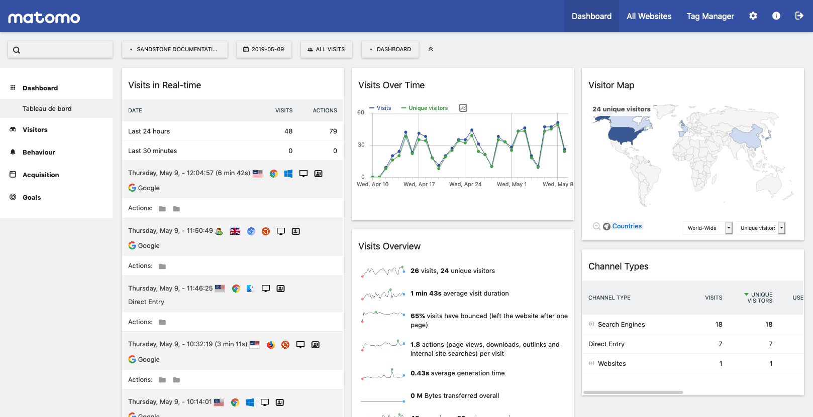
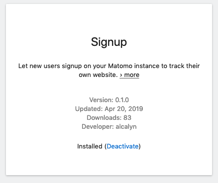

*Cet article a été traduit de l'anglais.*

- Plugin Signup sur la marketplace Matomo : <https://plugins.matomo.org/Signup>
- Dépôt Github : <https://github.com/alcalyn/matomo-plugin-signup>

## Qu'est-ce que Matomo

Matomo est une alternative libre à Google analytics.

Si vous voulez analyser les utilisateurs qui interagissent avec votre site web,
vous pouvez héberger votre propre instance Matomo et ajouter le tracking js sur votre site.

C'est ce que j'utilise sur ce blog.

## Pourquoi ce plugin ?

J'héberge donc ma propre instance de Matomo.
Mais je ne l'utilise que pour ce blog et un site de documentation,
ce qui laisse beaucoup de bande passante inutilisée sur mon serveur dédié.

Je voulais partager mon instance avec d'autres personnes
qui ont un petit blog et ne veulent pas installer leur propre instance
ni utiliser google analytics.

J'avais donc besoin d'ajouter un parcours d'inscription.

En cherchant quelque chose de déjà fait,
je n'ai trouvé qu'un [plugin non maintenu pour une vieille version de Piwik](https://github.com/eristoddle/PiwikSignupPlugin),
et quelques discussions dans les issues Github du dépôt Matomo
([#8358](https://github.com/matomo-org/matomo/issues/8358),
[#7622](https://github.com/matomo-org/matomo/issues/7622)).

J'ai lu dans ces discussions que ce plugin était en fait très attendu, et qu'il pouvait aussi répondre à d'autres cas d'usage.

Donc « pourquoi ce plugin ? » :

- Partager publiquement son instance (la mienne)
- Dans une instance privée (une organisation par exemple), permettre aux nouveaux contributeurs de créer leur accès au lieu de le demander à l'administrateur

## Ce dont j'ai eu besoin pour construire ce plugin

- [La documentation développeur de Matomo](https://developer.matomo.org/develop) m'a beaucoup aidé à démarrer le développement de mon plugin.
- [Tous les plugins existants de Matomo](https://github.com/matomo-org/matomo/tree/3.x-dev/plugins) ont aussi été une mine d'or : j'ai regardé le code source de plugins qui font des choses similaires.

Ce plugin est disponible sur la marketplace Matomo, ou téléchargeable depuis le dépôt github.
Vous pouvez l'installer directement depuis votre interface d'administration.


